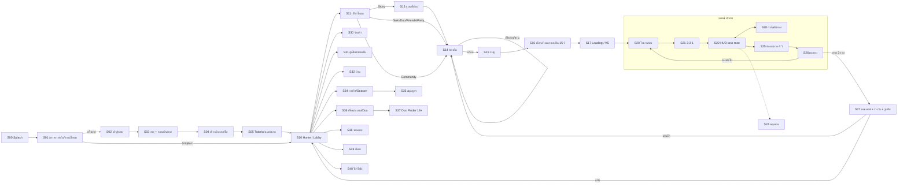

# 11 · UX/UI Spec — หน้าจอ ปุ่ม และ Component ทั้งเกม

เวอร์ชัน 0.2 · 13 พ.ย. 2026 · สถานะ: ร่างเพื่อรีวิว

> **อัปเดต 0.2 (13 พ.ย. 2026): เปลี่ยนรอบเล่นเป็น Task Race** ตาม GDD หัวข้อ 3 และ `16_Task_Race_Minigame_Spec.md` ใบงานกลายเป็นรายการ task ของทีม, HUD มีแถบความคืบหน้าทีมเรา + คู่แข่ง, มินิเกมเปิดเป็นการ์ด overlay (S28 ใหม่), ช่วงทดสอบ 10 วิ กลายเป็น "ห้องสะอาด" 4 วิ ข้อที่แก้: S20, S22, S25, S26, S28, ข้อ 3.1, 8.4, 8.5, 11, 12 ของเดิมที่ยังใช้กับรถเข็น (T04) ยังอยู่ครบ
Wireframe ภาพรวม (เปิดในเบราว์เซอร์): [`ux/BOB_UX_Wireframes.html`](ux/BOB_UX_Wireframes.html)

เอกสารนี้คือสเปก UX/UI ฉบับเต็มของ BOB (co-op simulator จัดชั้นรถเข็น, มือถือแนวนอน, Unity 2.5D) ครอบคลุมทุกหน้าจอตั้งแต่เปิดแอปจนจบแมตช์ ระบบ component พร้อมขนาด สถานะ เสียงและการสั่น และวิธีทำใน Unity
ยึด GDD เป็นแหล่งความจริงของกติกา (หัวข้อ 3, 4, 6, 7, 9, 12, 17, 20, 22) และยึด `00_Art_Direction.md` เป็นแหล่งความจริงของภาพ

---

## 0. หลัก UX 6 ข้อของเกมนี้

| # | หลัก | ผลต่อการออกแบบ |
| --- | --- | --- |
| 1 | **จัดชุดแรกสำเร็จใน 30 วินาทีโดยไม่อ่าน** (GDD 9) | สอนด้วยการทำ (ghost hand + ไฮไลต์) ไม่ใช่หน้าข้อความ, ปุ่มหลักต่อจอมีปุ่มเดียวที่เด่นที่สุด |
| 2 | **นิ้วเดียวเล่นจบได้** | ทุกอย่างในแมตช์ทำได้ด้วยแตะ/ลาก ไม่มี gesture 2 นิ้ว, เดินได้ทั้งจอยสติ๊กและแตะจุดหมาย |
| 3 | **ไม่มีใครถูกโทษ** (GDD 1, 4) | ไม่มีหน้าจอ/ตัวเลขรายบุคคล, ข้อความผิดพลาดพูดถึง "ทีม" หรือ "กอง" ไม่ชี้ตัวคน, Quick Ping มีแต่ข้อความบวก |
| 4 | **ข้อมูลในแมตช์ต้องเห็นได้ในครึ่งวินาที** | แถบค่า 4 ตัวพร้อมเส้นเป้า, ไอคอน + สี + ลาย คู่กันเสมอ, ข้อความในแมตช์ไม่เกิน 6 คำ |
| 5 | **ซื้อได้แค่รูปลักษณ์ เห็นของก่อนจ่าย** (GDD 7, 15) | ไม่มีกล่องสุ่ม ไม่มี timer กดดัน, ทุกการซื้อมี preview + ยืนยัน, ผู้เยาว์ยืนยันซ้ำ |
| 6 | **ปลอดภัยไว้ก่อน** (GDD 12) | Block/Report แตะเดียวทุกที่ที่เห็นผู้เล่นอื่น, Duo Finder ซ่อนจากผู้เยาว์ทั้งหมด |

---

## 1. Canvas, หน่วย และขนาดอ้างอิง

### 1.1 หน่วย

- **Reference resolution 1920 × 1080**, `CanvasScaler = Scale With Screen Size`, `Match = 1 (Height)` เหมือน PR #2
- ในเอกสารนี้ **u = 1 หน่วยของ canvas อ้างอิง** (เท่ากับ 1 px ที่ 1920×1080)
- เพราะ match ความสูง ความสูงจอคงที่ 1080u เสมอ แต่ความกว้างเปลี่ยนตามอัตราส่วนจอ:

| อุปกรณ์ | อัตราส่วน | ความกว้าง canvas | 1 dp เท่ากับ |
| --- | --- | --- | --- |
| iPad / แท็บเล็ต 4:3 | 1.33 | 1440u | ~1.4u |
| มือถือ 16:9 | 1.78 | 1920u | ~3.0u |
| มือถือ 19.5:9 – 20:9 (ส่วนใหญ่ปัจจุบัน) | 2.17–2.22 | 2340–2400u | ~2.75–3.0u |
| มือถือ 21:9 | 2.33 | 2520u | ~2.6u |

> **กฎแปลงหน่วยที่ใช้ทั้งเอกสาร: 1 dp ≈ 3u** (คิดจากมือถือแนวนอนที่สูง 360 dp ซึ่งเป็นเคสเล็กสุดที่รองรับ) ดังนั้น **48 dp = 144u**
> เลย์เอาต์ทุกจอต้องใช้ได้ตั้งแต่กว้าง 1440u ถึง 2520u: ยึดของด้วย anchor ซ้าย/ขวา ห้ามวางตำแหน่งตายตัวจากกลางจอสำหรับของที่ต้องกด

### 1.2 Touch target

| ประเภท | ขนาดขั้นต่ำ (พื้นที่กด) | ขนาดแนะนำ | หมายเหตุ |
| --- | --- | --- | --- |
| ทั่วไป (เมนู, ปิด, แท็บ) | **144u (48 dp)** | 160u | ภาพไอคอนเล็กกว่านี้ได้ แต่ hit area ต้องถึง |
| ปุ่มในแมตช์ (มือ, ชั้นวาง, ability) | 160u | 176–200u | กดขณะตามองฉาก จึงต้องใหญ่กว่า |
| ปุ่มหลักต่อจอ (เล่น, ส่งทดสอบ) | สูง 160u | 180u × 420–520u | อยู่ในโซนนิ้วโป้งขวาเสมอ |
| ระยะห่างระหว่างเป้ากด | 16u | 24u | กันกดพลาด |

> **ข้อแก้ให้ PR #2:** โค้ด HUD ปัจจุบันตั้งเป้ากดขั้นต่ำ 96u (≈ 32 dp บนมือถือ) ซึ่งเล็กกว่ามาตรฐาน 48 dp ควรขยาย hit area เป็น ≥ 144u (ใช้ `Image.raycastPadding` ค่าติดลบ หรือวาง Image โปร่งใสขนาด 144u เป็น hit area) โดยไม่ต้องขยายภาพ

### 1.3 Safe area และรอยบาก

- ใช้ `Screen.safeArea` ปรับ RectTransform ชื่อ `SafeArea` ใต้ทุก Canvas (component `BobSafeArea`) ทำงานทุกครั้งที่จอหมุน/เปลี่ยนขนาด
- **พื้นหลัง ฉาก และ dim ของ modal วางเต็มจอ (นอก SafeArea)** ส่วนปุ่ม ข้อความ และ HUD วางใน SafeArea
- แนวนอนมีรอยบากด้านซ้ายหรือขวา (iPhone ~132u, Android punch-hole ~90u) และ home indicator ด้านล่าง (~60u) เผื่อขอบด้านในเพิ่ม **24u** จากขอบ SafeArea เสมอ
- ล็อกแนวนอนทั้งสองทิศ (`Landscape Left` + `Landscape Right`, ปิด Portrait) เมนูทั้งหมดออกแบบแนวนอน (ปรับจาก Art Direction ที่เผื่อ portrait: ทำแนวเดียวลดงานครึ่งหนึ่ง)

### 1.4 โซนนิ้วโป้ง (ถือมือถือแนวนอนสองมือ)

```
┌──────────────────────────────────────────────────────────────┐
│  ข้อมูลอ่านอย่างเดียว (ตามองถึง นิ้วไม่ถึง)                         │
│  ┌─────────┐                                  ┌─────────┐    │
│  │ กดได้แต่  │       กลางจอ: ฉากเกม / เนื้อหา        │ กดได้แต่  │    │
│  │ ยืดนิ้ว    │       (แตะเดินได้ แต่ไม่วางปุ่ม)        │ ยืดนิ้ว    │    │
│  ├─────────┤                                  ├─────────┤    │
│  │ ★ โซนโป้ง │                                  │ ★ โซนโป้ง │    │
│  │ ซ้าย:     │                                  │ ขวา: ปุ่ม  │    │
│  │ เดิน/เลือก │                                  │ หลัก/ยืนยัน │    │
│  └─────────┘                                  └─────────┘    │
└──────────────────────────────────────────────────────────────┘
   โซนโป้ง ≈ 35% ความกว้าง × 50% ความสูงล่าง แต่ละข้าง
```

- **ปุ่มหลักทุกจอ (เล่น, ยืนยัน, ส่งทดสอบ, ต่อไป) อยู่ล่างขวา** ผู้เล่นจะเรียนรู้ตำแหน่งเดียว
- **ปุ่มย้อนกลับ/ปิดอยู่บนซ้าย** (เมนู) หรือบนขวา (popup) ตามธรรมเนียม และ Android Back ทำงานเหมือนกันทุกจอ
- ตั้งค่า **"โหมดมือซ้าย"** สลับ HUD ในแมตช์ซ้าย-ขวาทั้งหมด (จอยสติ๊กไปขวา ปุ่มไปซ้าย)

---

## 2. Design Tokens

### 2.1 สี (อิง Master Palette ใน `00_Art_Direction.md`)

| Token | HEX | ใช้กับ | ตัวหนังสือบนสีนี้ (contrast) |
| --- | --- | --- | --- |
| `ink` | `#041E4F` Deep Navy | ตัวหนังสือหลัก, เส้นขอบปุ่ม | — |
| `ink.muted` | `#5A5F7A` | ตัวหนังสือรอง | บน `surface` 6.2:1 |
| `frame` | `#2E4484` Navy | กรอบ panel, หัวข้อ ribbon, ปุ่ม icon | ขาว 9.2:1 |
| `surface` | `#FFFDF5` | การ์ด, panel ด้านใน | `ink` 15.8:1 |
| `surface.cream` | `#FEEECF` Cream | panel หลัก (ตาม Leonardo `ui_panel_blue`) | `ink` 14.1:1 |
| `primary` | `#F6C431` Gold → `#FFD166` | ปุ่มเล่น/ยืนยันหลัก (ไล่สีบนลงล่าง) | **`ink` 9.9:1** (ห้ามตัวขาว) |
| `accent` | `#FD7713` BOB Orange | ปุ่มรอง-เด่น, ป้าย NEW, แถบเลือก | `ink` 6.0:1 (ห้ามตัวขาว: 2.7:1) |
| `secondary` | `#1A6FC4` (เข้มจาก Sky `#3695F2`) | ปุ่ม secondary, แท็บที่เลือก | ขาว 5.1:1 |
| `sky` | `#3695F2` | พื้นหลังไล่สี, น้ำ, ไฮไลต์ | ขาวได้เฉพาะตัวใหญ่ ≥ 48u ตัวหนา + ขอบ `ink` (3.1:1) |
| `brand.red` | `#FB2F44` | โลโก้, badge แจ้งเตือน | — |
| `success` | `#178A4F` | ส่งทดสอบ, ผ่านสเปก, ชนะ | ขาว 4.4:1 |
| `danger` | `#D81E36` | ลบ/ออก, เวลาใกล้หมด, ไม่ผ่าน | ขาว 5.1:1 |
| `warn` | `#FD7713` | ปฏิกิริยาหักล้าง (ส้ม ตาม GDD 9) | `ink` |
| `good.spark` | `#3DDC84` | ประกายปฏิกิริยาเสริมกัน (เขียว) | — |
| `dim` | `#041E4F` @ 70% | ฉากหลังของ modal | — |
| `hero.sweep / bubble / press / spray` | `#F79A2E` / `#3D8FE0` / `#2FA97A` / `#8E6BD8` | การ์ดตัวละคร, ชื่อ, ป้ายผู้เล่น | — |
| `family.tool / chem / energy / method` | `#F4A340` / `#4EA8DE` / `#EF476F` / `#9B7EDE` | ตระกูลชิ้นส่วน (มีไอคอนรูปร่างคู่เสมอ ดู 9) | — |

> PR #2 ใช้ชุดสี `BobUi` (Bg `#FFF6DC`, Teal `#1FA6A0`, Rose `#EF476F`) ซึ่งเป็นสี placeholder ก่อนมี concept เสนอให้ย้ายไปใช้ token ชุดนี้ผ่าน `BobUiTheme` (ดู 10.3) โดย Teal ของปุ่มส่งทดสอบเปลี่ยนเป็น `success`

### 2.2 ตัวอักษร (ไทย + อังกฤษ)

| Token | ฟอนต์ | ขนาด (u) | ≈ sp | line-height | ใช้กับ |
| --- | --- | --- | --- | --- | --- |
| `display` | Mitr SemiBold | 120 | 40 | 1.3 | 3-2-1, ชนะ/แพ้ |
| `h1` | Mitr SemiBold | 72 | 24 | 1.35 | ชื่อหน้าจอ, banner |
| `h2` | Mitr Medium | 56 | 19 | 1.4 | หัวการ์ด, ชื่อตัวละคร |
| `button.lg` | Mitr SemiBold | 60 | 20 | 1.2 | ปุ่มหลัก |
| `button` | Mitr Medium | 46 | 15 | 1.2 | ปุ่มทั่วไป, แท็บ |
| `body` | IBM Plex Sans Thai Medium | 42 | 14 | 1.6 | เนื้อความ |
| `caption` | IBM Plex Sans Thai Medium | 36 | 12 | 1.6 | ป้ายรอง, ราคา, ชื่อชิ้นส่วน (**ขั้นต่ำ ห้ามเล็กกว่านี้**) |
| `number` | Mitr SemiBold (tabular figures) | 48–96 | — | 1.1 | เวลา, งบ, เหรียญ |

- ทั้งสองฟอนต์เป็น **SIL OFL** ฝังในเกมได้ (สอดคล้อง F11 ใน `02_Asset_List.md`), fallback: Noto Sans Thai
- **ภาษาไทยต้องมี line-height ≥ 1.5** เพราะสระบน/ล่างและวรรณยุกต์ซ้อน (เช่น "ปุ๊", "ญู") ถ้าใกล้กว่านี้จะชนบรรทัดบน
- **ห้ามใช้ตัวพิมพ์ใหญ่ทั้งหมดและห้ามบีบตัวอักษร** ภาษาไทยไม่มีตัวพิมพ์ใหญ่ หัวข้อภาษาอังกฤษใช้ Title Case
- ข้อความบนปุ่ม/ป้ายในแมตช์ใช้ **ขอบตัวอักษร (outline) `ink` 4–6u** แทน drop shadow เพราะอ่านบนฉากสีสดได้ดีกว่า
- **การตัดบรรทัดภาษาไทย:** ภาษาไทยไม่เว้นวรรคระหว่างคำ TextMeshPro จะตัดกลางคำ ให้ใส่ zero-width space (`U+200B`) ระหว่างคำในไฟล์ localization ตอน build (ตัดคำด้วยพจนานุกรม เช่น PyThaiNLP แบบ offline) ห้ามตัดคำตอนรันบนเครื่อง
- **เผื่อความยาว 35%:** ข้อความไทยมักยาวกว่าอังกฤษ และอังกฤษบางคำยาวกว่าไทย ปุ่มใช้ `ContentSizeFitter` + ขนาดต่ำสุด ไม่ใช้ Auto Size ย่อตัวอักษรต่ำกว่า `caption`
- ตัวเลขใช้เลขอารบิกทั้งเกม ราคาจริงแสดงตามสกุลเงินของร้านค้า (StoreKit/Play Billing ส่งมาเป็นข้อความพร้อมสกุลแล้ว ห้ามแปลงเอง)

### 2.3 ระยะ มุม เส้น เงา

| Token | ค่า |
| --- | --- |
| Grid | 8u (ทุกระยะเป็นทวีคูณ 8) |
| `space.xs / s / m / l / xl` | 8 / 16 / 24 / 40 / 64u |
| `radius.s / m / l / pill` | 16 / 28 / 44u / ครึ่งความสูง |
| `stroke` | เส้นขอบ `ink` 5u (ปุ่ม, การ์ด), 3u (ชิป) |
| `elevation` ปุ่ม (ทรงของเล่นตาม Leonardo `ui_button_play`) | เงาทึบด้านล่าง 10u สี `ink` 35% + ไฮไลต์มันบนครึ่งบน |
| `elevation` panel | เงานุ่ม y −12u blur 24u สี `ink` 25% |

### 2.4 การเคลื่อนไหว

| Token | ระยะเวลา | Easing | ใช้กับ |
| --- | --- | --- | --- |
| `press` | 70 ms ลง / 120 ms ขึ้น | OutQuad / OutBack | ปุ่มยุบ: ขยับลง 8u + scale 0.96 + เงาหด |
| `pop` | 220 ms | OutBack (1.6) | popup, toast, ชิ้นส่วนลงรถเข็น |
| `slide` | 280 ms | OutCubic | เปลี่ยนแท็บ, sheet ข้าง |
| `screen` | 450 ms | InOutCubic | เปลี่ยนหน้าจอ (bubble wipe ตาม Leonardo `transition_wipe`) |
| `countup` | 600–1200 ms | OutCubic | คะแนน, เหรียญ |
| ตั้งค่า **ลดการเคลื่อนไหว** | ทุกอย่าง ≤ 150 ms, ตัด shake/flash, wipe → fade | | |

---

## 3. แผนผังหน้าจอ (Screen Map)



### 3.1 รายการหน้าจอทั้งหมด

| ID | หน้าจอ | ประเภท | Pri | Leonardo ref (`leonardo_raw/`) | หมายเหตุ |
| --- | --- | --- | --- | --- | --- |
| S00 | Splash | Full | P0 | `ui/logo_bob_base_*` | โลโก้ + เสียงไม้กวาด 1.5 วิ |
| S01 | ตรวจเวอร์ชัน / ดาวน์โหลด / Loading | Full | P0 | `screens/screen_loading_*` | แถบโหลด + tip สลับ |
| S02 | เข้าสู่ระบบ | Full | P0 | `screens/screen_login_*` | Guest / Google / Apple |
| S03 | ยืนยันอายุ + ความยินยอม | Modal | P0 | — | วันเกิด → ตั้งเพดานจ่าย/ซ่อน Duo Finder |
| S04 | ตั้งชื่อ + เลือกตัวละครแรก | Full | P0 | `screens/screen_character_select_*` | ตรวจคำหยาบฝั่งเซิร์ฟเวอร์ |
| S05 | Tutorial แมตช์แรก | In-game overlay | P0 | — | coach mark บน HUD จริง |
| S10 | Home / Lobby | Full | P0 | `screens/screen_lobby_*`, `screen_menu_*`, `lobby_backgrounds/*` | หน้าหลัก |
| S11 | เลือกโหมด | Full | P0 | `screens/screen_menu_*` | Story / Solo / Duo / Friends / Party / Community |
| S13 | แผนที่ด่าน (Story) | Full | P0 | `screens/screen_stage_select_*` | 6 บท, ดาว 3 ดวงต่อด่าน |
| S14 | ห้องทีม (Room / Party) | Full | P0 | `lobby_backgrounds/*` | รหัสห้อง, ชวน, พร้อม |
| S15 | จับคู่ | Overlay | P0 | `screens/screen_loading_*` | เวลาโดยประมาณ, ยกเลิก |
| S16 | เลือกตัวละครในแมตช์ | Full | P0 | `screens/screen_character_select_*` | เลือกแบบปิด 15 วิ ห้ามซ้ำในทีม |
| S17 | Loading / VS | Full | P0 | `screens/transition_frame_*` | ทีมเรา vs คู่แข่ง |
| S20 | ใบงานห้อง (Round brief) | Modal | P0 | — | **รายการ task ของทีม** + ศัตรูฉุกเฉินที่จะเจอ + สูตรรถเข็น T04 (เดิม: สเปก + งบ ใน PR #2) |
| S21 | 3-2-1 | Overlay | P0 | — | มีใน PR #2 |
| S22 | HUD task race | HUD | P0 | `ui/ui_button_skill_*`, `icon_skill_*` | รายการ task + แถบทีม/คู่แข่ง ดูข้อ 5 |
| S23 | ชั้นวางของ (Station shelf) | HUD popover | P0 | — | มีใน PR #2 |
| S24 | หยุดเกม | Modal | P0 | `screens/screen_menu_*` (แผง Pause) | ในแมตช์ออนไลน์เวลาไม่หยุด |
| S25 | ห้องสะอาด (ก่อน-หลัง) | Full | P0 | `backgrounds/bg_*` + `bg_*_dirty_*` | แบ่งครึ่งจอ 4 วิ แสดง % สองทีม (ยังไม่ทำ) |
| S26 | ผลรอบ | Full | P0 | — | มีใน PR #2 |
| S27 | ผลแมตช์ + รางวัล + รูปทีม | Full | P0 | `screens/screen_result_*`, `items/item_chest_*` | ไม่มีสถิติรายคน |
| S28 | การ์ดมินิเกม (Minigame host) | Overlay | P0 | `mini_bg_*` (ใหม่) | ใหม่ 0.2: การ์ด 1400 × 860u ดูข้อ 5 |
| S30 | ร้านค้า | Full | P1 | `ui/ui_panel_blue_*` | แฟชั่น / บ้าน / Season / แพ็ก |
| S31 | ตู้เสื้อผ้า + ตัดเย็บ | Full | P1 | `heroes/*` | ซ้อน 4 ชั้น ผ้า+สี+ลาย+เครื่องประดับ |
| S32 | บ้าน (แต่ง/เยี่ยม) | Full 3D | P2 | `lobby_backgrounds/*` | |
| S33 | กระเป๋า (Inventory) | Tab ใน S31 | P1 | — | ของที่มี + เศษวัสดุ |
| S34 | ภารกิจ + Season Track | Full | P1 | `items/item_trophy_*` | รายวัน/สัปดาห์/ซีซัน |
| S35 | สมุดสูตร | Full | P2 | — | ปฏิกิริยาที่ค้นพบ |
| S36 | เพื่อน / ชมรม / Duo | Full | P1 | — | รายชื่อ, ชวน, รหัสเพื่อน |
| S37 | Duo Finder (18+) | Full | P2 | — | ปิดค่าเริ่มต้น, ขั้นตอนตาม GDD 12 |
| S38 | จดหมาย / ของขวัญ | Full | P1 | — | รับทั้งหมด, หมดอายุ |
| S39 | ตั้งค่า | Full (แท็บ) | P0 | `screens/screen_menu_*` | เสียง, ควบคุม, การแสดงผล, บัญชี |
| S40 | โปรไฟล์ | Sheet | P1 | `ui/ui_portrait_frame_*` | ชื่อ, ระดับ, ชุด, บล็อก/รายงาน |
| P01–P09 | Popup ระบบ | Modal | P0 | `ui/ui_panel_blue_*` | ดูข้อ 7 |

---

## 4. สเปกรายหน้าจอ (นอกแมตช์)

รูปแบบทุกจอ: **Top bar** (สูง 128u: ปุ่มกลับ/ชื่อหน้าซ้าย, สกุลเงินขวา) + **เนื้อหา** + **ปุ่มหลักล่างขวา** ถ้ามี

### S00 Splash → S01 ตรวจเวอร์ชัน/ดาวน์โหลด

- Splash: โลโก้ BOB pop-in (`pop`) บนพื้นไล่สี sky → ขาว, เสียง `broom_sweep` + โลโก้ 1.5 วิ ห้ามนานกว่า 2.5 วิ
- S01 ใช้ภาพ `screen_loading` (4 ฮีโร่ในทางเดิน) เต็มจอ แถบโหลดแบบ `BAR-Progress-L` (1100 × 72u) กลางล่าง ข้อความใต้แถบ: "กำลังเตรียมรถเข็น… 45%" + ขนาดไฟล์ "12.4 / 38 MB"
- **ดาวน์โหลดเกิน 50 MB บนเน็ตมือถือ** → popup `P03` ถามก่อน ("ดาวน์โหลดตอนนี้ / รอ Wi-Fi")
- **ต้องอัปเดตแอป** → popup `P06` ปุ่มเดียว "ไปที่ร้านค้า" (ปิดไม่ได้)
- tip สลับทุก 4 วิ จากชุดคำแนะนำการซ้อน (ใช้สอนโดยไม่ต้องมีหน้าคู่มือ)
- ล้มเหลว → `P04` "โหลดไม่สำเร็จ ลองอีกครั้ง" + ปุ่ม "ลองใหม่" (retry อัตโนมัติ 3 ครั้งก่อนแสดง)

### S02 เข้าสู่ระบบ

- ภาพ `screen_login` (หน้าโรงเรียน + 4 ฮีโร่) ด้านซ้าย 60%, panel ครีม 680 × 760u ด้านขวา
- ปุ่มเรียงลง: **"เล่นเลย (Guest)"** `BTN-Primary` → "เข้าด้วย Google" / "เข้าด้วย Apple" (iOS เท่านั้น ตามกฎ App Store ถ้ามี social login อื่น) `BTN-Secondary` แบบมีโลโก้ตามแนวทางแบรนด์ของผู้ให้บริการ
- ลิงก์เล็กล่าง panel: นโยบายความเป็นส่วนตัว · ข้อตกลง (เป้ากด 144u แม้ตัวเล็ก)
- Guest: เตือนผูกบัญชีหลังจบแมตช์ที่ 3 (ไม่บังคับ)

### S03 ยืนยันอายุ + ความยินยอม

- ถามวันเดือนปีเกิดด้วย picker 3 วงล้อ (ไม่ใช่ช่องพิมพ์) แบบกลางๆ ไม่มีค่าเริ่มต้นที่เป็นผู้ใหญ่
- ผลลัพธ์: **< 18** → ซ่อน Duo Finder, แชทเปิดเฉพาะเพื่อนที่เพิ่มแล้ว, เพดานจ่ายรายเดือน, ยืนยันทุกการซื้อ; **≥ 18** → เปิดทุกอย่าง (Duo Finder ยังปิดจนกว่าจะเปิดเอง)
- ความยินยอม PDPA แยกช่อง: วิเคราะห์การเล่น (จำเป็นต่อการปรับสมดุล), โฆษณาแบบเลือกดู, แจ้งเตือน ห้ามติ๊กไว้ก่อน

### S04 ตั้งชื่อ + ตัวละครแรก

- ซ้าย: ตัวละครหมุนได้บนแท่น (ลากเพื่อหมุน) / ขวา: ช่องชื่อ 3–12 ตัวอักษร + ปุ่ม "สุ่มชื่อ" (ไอคอนลูกเต๋า) + การ์ดเลือก 4 ฮีโร่แนวนอน
- ตรวจชื่อซ้ำ/คำไม่เหมาะ ฝั่งเซิร์ฟเวอร์ แสดงผลใต้ช่องทันทีที่หยุดพิมพ์ 400 ms
- "ไปกันเลย" `BTN-Primary` ล่างขวา → เข้า Tutorial

### S05 Tutorial (แมตช์แรก, ระดับ 1)

ห้องเช่าเล็ก (GDD 20) สเปก 1 เงื่อนไข ไม่มี ability ไม่มีคู่แข่งจริง สอนด้วย **coach mark** บน HUD จริง 6 ขั้น เป้ารวม ≤ 30 วินาที

| ขั้น | สิ่งที่เห็น | ผู้เล่นทำ | ผ่านเมื่อ |
| --- | --- | --- | --- |
| 1 | วงแสงรอบจอยสติ๊ก + มือผีลาก | เดินไปชั้นวางอุปกรณ์ (มีลูกศรพื้น) | ถึงระยะชั้นวาง |
| 2 | ชั้นวางเด้งขึ้น ไฮไลต์ "ฟองน้ำ" | แตะหยิบ | ของเข้ามือ |
| 3 | มือผีลากจากช่องมือไปรถเข็น | ลากวาง | ชั้น 1 ลงรถเข็น แถบค่าขยับ |
| 4 | ไฮไลต์แถบ "ขจัดคราบ" + เส้นเป้า | ไปหยิบ "สบู่" แล้ววาง | ประกายเขียวระหว่างชั้น |
| 5 | ไฮไลต์ปุ่ม "ส่งทดสอบ" | กด | — |
| 6 | ช่วงทดสอบ ก่อน-หลัง + "สะอาดแล้ว!" | — | จบ |

- dim รอบจุดที่สอน 60% แต่ **ไม่บล็อกการแตะส่วนอื่น** (กันผู้เล่นรู้สึกถูกบังคับ) มีปุ่ม "ข้าม" บนขวาเสมอ
- ระดับ 6 ปลดล็อก ability → ด่านสอน ability สั้นในบท 2 (GDD 17 กฎ 10)

### S10 Home / Lobby (หน้าหลัก)

```
┌───────────────────────────────────────────────────────────────────────────┐
│[รูป Lv.12 ชื่อ ▓▓▓░ XP]   [ภารกิจ•][Season]          [🪙 1,250 +][💎 40 +][✉•][⚙]│ ← Top bar 128u
│                                                                           │
│ ┌ แบนเนอร์ ┐                     ฮีโร่ 3D บนแท่น                ┌──────────┐ │
│ │ ซีซัน/อีเวนต์│                   (แตะ = ท่าทาง, ลาก = หมุน)          │ เพื่อน 3 ออนไลน์│ │
│ │ 640×280   │                                                 │ [+ชวน]     │ │
│ └──────────┘                 ทีม/ห้องปัจจุบัน: ช่องเพื่อน 3 ช่อง       └──────────┘ │
│                                                                           │
│ [ร้านค้า][ตู้เสื้อผ้า][บ้าน][เพื่อน][สมุดสูตร]          [โหมด: Duo ▾] [   เล่น   ]│ ← dock 176u / ปุ่มเล่น 520×200u
└───────────────────────────────────────────────────────────────────────────┘
```

- **ปุ่ม "เล่น" (`BTN-Primary-XL` 520 × 200u) ล่างขวาสุด** เด่นที่สุดในจอ ไล่สีทองตาม `ui_button_play` ด้านซ้ายมี selector โหมดปัจจุบัน (`BTN-Secondary` 300 × 160u) แตะเปิด S11
- Dock ล่างซ้าย: 5 ปุ่มไอคอน+ป้าย (176 × 176u, ป้าย caption ใต้ไอคอน) badge จุดแดงเมื่อมีของใหม่
- ฉากหลังหมุนเวียนจาก `lobby_backgrounds` (ห้องเรียน, โรงอาหาร, สนาม, ทางเดินเช้า, ห้องสมุด, ดาดฟ้าเย็น) ตามเวลาจริงของเครื่อง
- ช่องเพื่อนกลางจอ: เมื่อมีคนเข้าห้อง ฮีโร่ของเพื่อนยืนข้างเรา (สูงสุด 4) แตะช่องว่าง = ชวนเพื่อน
- สถานะเน็ต: ออฟไลน์ → แถบ `BANNER-Offline` ใต้ top bar + ปุ่มเล่นเปลี่ยนเป็น "เล่นออฟไลน์ (Solo กับคู่แข่งจำลอง)"
- Android Back บนหน้านี้ → `P01` "ออกจากเกม?"

### S11 เลือกโหมด

- การ์ดโหมดแนวนอน 5 ใบ (`CARD-Mode` 400 × 600u) เลื่อนซ้าย-ขวา: Story · Solo · Duo · Friends · Party · Community
- แต่ละใบ: ภาพประกอบ, ชื่อ, จำนวนคน (ไอคอนคน × n), ความยาว ("6 นาที"), สถานะ (Community: "เปิด 20:00 วันนี้" ถ้าเป็นรอบเวลา)
- โหมดที่ยังล็อก: การ์ดสีเทา + กุญแจ + เงื่อนไข ("ปลดที่ระดับ 6") แตะได้เพื่อดูเงื่อนไข (ไม่เงียบ)
- ปุ่ม "เลือก" ล่างขวา; แตะการ์ดซ้ำ = เลือกเลย

### S13 แผนที่ด่าน (Story)

- อิง `screen_stage_select` แผนที่ชุมชน/โรงเรียนเลื่อนแนวนอน หมุดด่านเป็นวงกลม 160u มีดาว 0–3 ใต้หมุด, บทถัดไปล็อกด้วยเมฆ
- แถบซ้าย (ตามภาพ Leonardo) = รายการบท 1–6 แนวตั้ง แตะเพื่อเลื่อนแผนที่ไปบทนั้น
- แตะหมุด → side sheet ขวา 720u: ชื่อห้อง, ศัตรูที่อาจพบ (ไอคอน), สเปกตัวอย่าง, ดาวที่ได้, ปุ่ม "เล่นด่านนี้" + "ชวนเพื่อน"
- ฉากในแผนที่ตอนนี้ใช้ชุดโรงเรียนตาม concept (ห้องเรียน, โรงอาหาร, สนามเด็กเล่น, ห้องหม้อไอน้ำ = ด่านบอส) บทอื่นของ GDD 11 เพิ่มเป็นชุดฉากภายหลัง

### S14 ห้องทีม (Room / Party lobby)

```
┌──────────────────────────────────────────────────────────────────────┐
│[←] ห้อง Friends · รหัส 7K4Q  [คัดลอก][แชร์ลิงก์]                   [⚙ ห้อง] │
│                                                                      │
│   ┌──────┐ ┌──────┐ ┌──────┐ ┌──────┐                                 │
│   │ ฮีโร่  │ │ ฮีโร่  │ │  +   │ │  +   │   ทีมเรา (ช่องตามโหมด)            │
│   │ ชื่อ ✓ │ │ ชื่อ … │ │ ชวน  │ │ ชวน  │                                 │
│   └──────┘ └──────┘ └──────┘ └──────┘                                 │
│  ┌ ตั้งค่าห้อง (เจ้าของ) ─────────────┐   ┌ แชทสั้น / Quick Ping ──────┐   │
│  │ ฉาก: ห้องเรียน ▾  ระดับ: ปกติ ▾     │   │ "พร้อมแล้ว!" "รอแป๊บ"       │   │
│  └───────────────────────────────┘   └───────────────────────┘   │
│                                       [ออกจากห้อง]     [ พร้อม ✓ ]    │
└──────────────────────────────────────────────────────────────────────┘
```

- การ์ดสมาชิก `CARD-Member` 300 × 400u: ฮีโร่ (ชุดที่แต่ง), ชื่อ, สถานะพร้อม (✓ เขียว + ข้อความ "พร้อม" ไม่ใช่สีอย่างเดียว), มงกุฎเล็กสำหรับเจ้าของ
- แตะการ์ดเพื่อน → เมนูสั้น: ดูโปรไฟล์ · ให้เป็นเจ้าของ (เจ้าของเท่านั้น) · นำออก (เจ้าของ, ยืนยันก่อน) · **บล็อก/รายงาน**
- ปุ่มหลัก: สมาชิก = "พร้อม" (toggle), เจ้าของ = "เริ่ม" (ใช้ได้เมื่อทุกคนพร้อม; ถ้าไม่พร้อมแสดงเหตุผลใต้ปุ่ม "รออีก 1 คน")
- Party: แสดงข้อความ "ทุกรอบสลับทีม" และไม่มีตารางคนเก่ง; Community: แสดงหน่วย 5 หน่วย + เป้าทอง/เงิน/ทองแดง

### S15 จับคู่

- Overlay ทับ S14 (ไม่ทิ้งหน้าห้อง) วงฟองหมุน + "กำลังหาทีมคู่แข่ง… 0:12" + "โดยประมาณ ~0:30"
- ปุ่ม "ยกเลิก" `BTN-Tertiary` ล่างขวา (เป้ากด 160u)
- เกิน 60 วิ → ข้อเสนอ "เล่นกับผลงานที่บันทึกไว้แทน" (GDD 4 Solo) แบบไม่บังคับ
- เจอแล้ว: สั่น `success` + เสียง `ui_confirm` + เปลี่ยนเป็น S16 ด้วย wipe

### S16 เลือกตัวละครในแมตช์ (เลือกแบบปิด 15 วินาที)

- อิง `screen_character_select`: การ์ด 4 ใบ (`CARD-Hero` 360 × 560u) พื้นสีประจำตัว + ชื่อ + ability 1 บรรทัด + ปุ่ม "ยืนยัน" ใต้แต่ละการ์ดถูกแทนด้วย **ปุ่มยืนยันเดียวล่างขวา** (ลดการกดพลาด)
- นาฬิกา 15 วิ บนกลาง (`TIMER-Pill`) ใกล้หมด 5 วิ เปลี่ยน `danger` + ติ๊กทุกวินาที
- **ห้ามซ้ำในทีม** (GDD 17 กฎ 4): ตัวที่เพื่อนเลือกแล้วแสดงรูปเพื่อนเล็กมุมการ์ด + การ์ดหม่น + ป้าย "เพื่อนเลือกแล้ว" แตะไม่ได้
- ฝั่งคู่แข่งแสดงเป็นเงาดำ "?" จนเริ่มแมตช์ (กฎ 5)
- หมดเวลาไม่เลือก → ระบบเลือกตัวที่ยังว่างตามลำดับที่เล่นบ่อย และแสดง toast บอก
- แตะค้างการ์ด (400 ms) → tooltip อธิบาย ability เต็ม + ตัวอย่างการใช้ (GIF สั้น)

### S17 Loading / VS

- แบ่งจอทแยง (ใช้กรอบ `transition_frame`): ทีมเรา (ซ้าย, ฟ้า) vs คู่แข่ง (ขวา, ส้ม) แสดงฮีโร่ + ชื่อ, ไม่มีเลขระดับหรือสถิติ
- แถบโหลดบางล่าง + tip; ใช้เวลาจริงที่โหลดฉาก แต่อย่างน้อย 1.5 วิ เพื่อให้เห็นทีม

---

## 5. ในแมตช์ (S20–S27)

### S20 ใบงานห้อง (ก่อนทุกรอบ) — มีใน PR #2 แบบสเปก, **0.2 เปลี่ยนเป็นรายการ task**

- การ์ดกลางจอ 1240u กว้าง แบ่ง 2 คอลัมน์:
  - **ซ้าย (60%) รายการ task ของทีม:** แถวละ 88u: ไอคอนหมวด 64u · ชื่อสั้น (≤ 3 คำ เช่น "ถูคราบวน") · ประเภท (ขั้น "1/2", นาฬิกาสำหรับ task รอ, มือสองข้างสำหรับ common) · หน้าฮีโร่ที่ถนัดเล็ก 48u; ด้านบน "ทีมฟ้า · 0/6 งาน" และ "เป้า: เสร็จก่อนทีมแดง"
  - **ขวา (40%):** มินิแมปห้อง 480 × 300u มีหมุดจุดงานตามไอคอนหมวด, ศัตรูฉุกเฉินที่จะโผล่ (ภาพ idle 96u + ไอคอนมินิเกมจุดอ่อน ไม่บอกเวลา), สูตรรถเข็น T04 เป็นแถบค่า 4 ตัวย่อพร้อมเส้นเป้า (component เดียวกับเดิม) และงบ T04, การ์ดกติกา (Party)
- ตัวเลข "0/6" ใช้คำว่า "งาน" ทั้งเกม (ดูข้อ 13)
- ปุ่ม "เข้าใจแล้ว" ล่างขวา หรือรอ 6 วิ เริ่มเอง (นับถอยหลังเป็นวงรอบปุ่ม)
- ในทีมหลายคน: เห็นว่าใครกดเข้าใจแล้ว (ไอคอน ✓ ใต้รูปเพื่อน) เริ่มเมื่อทุกคนกดหรือครบเวลา

### S21 3-2-1 — มีใน PR #2

ตัวเลข `display` + ขอบ `ink` 6u, scale 1.4 → 1.0 ทุกวินาที, เสียง `timer_tick` และ `round_start` ตอน "เริ่ม!" สั่น light ทุกตัวเลข

### S22 HUD task race (หัวใจของเกม) — 0.2

> มุมกล้อง ฉากโรงอาหาร และปุ่มหลักตามบริบท ดูข้อ 5A และ [`ux/BOB_Play_Screen_Cafeteria.html`](ux/BOB_Play_Screen_Cafeteria.html) กติกาดู `16_Task_Race_Minigame_Spec.md`

```
┌────────────────────────────────────────────────────────────────────────────┐
│┌งานของทีม 4/6───┐   (●●○) [⏱ 1:12]  ทีมฟ้า ▓▓▓▓▓▓▓░░░ 67%  [💨] [⏸] │ top 0–160u
││🔴 สไลม์!   0:18 │                    ทีมแดง ▓▓▓▓▓░░░░░ 50%            │
││🖐 ยกตู้   (1/2) │                                                       │
││🛒 รถเข็น  1/2 🧽│                                                       │
││⏱ แช่คราบ  0:07 │              ฉากห้อง (แตะเพื่อเดิน)                     │
││🧹 กวาดทาง     ✓ │        (วงจุดงานบนพื้น + ไอคอนหมวด)                    │
│└ +2 ─────────────┘                                                         │
│ [เพื่อน: 🧽 กำลังทำ] [เพื่อน: ว่าง]                         ( ability )      │
│   (จอยสติ๊ก                                       [ ทำงาน: ถูคราบ ]         │
│    ลอยตามนิ้ว)                                                               │
└────────────────────────────────────────────────────────────────────────────┘
```

| พื้นที่ | Component | ขนาด / ตำแหน่ง | พฤติกรรม |
| --- | --- | --- | --- |
| รายการงาน (บนซ้าย) | `HUD-TaskList` (แทน `HUD-OrderTicket` ระหว่างรอบ) | กว้าง 20% ของ SafeArea (≥ 420u), แสดง 5 แถว แถวละ 72u, ที่เหลือพับ "+2" | หัว "งานของทีม 4/6"; แถว: ไอคอนหมวด · ชื่อ · ขั้น/นาฬิกา · หน้าฮีโร่ที่กำลังทำ (ล็อก) · ✓; เรียง ฉุกเฉิน (ขอบแดง + นับถอยหลัง 25 วิ) → common → long ที่รอครบแล้ว → short → เสร็จ (จางลงล่างสุด); **แตะแถว = ลูกศรนำทางในฉาก + จุดงานกะพริบ** |
| รอบ / เวลา (บนกลางซ้าย) | `PIPS-Round`, `TIMER-Pill` | ตามเดิม | เวลา ≤ 20 วิ → `danger` + pulse (ตรงกับดนตรี L4), ≤ 10 วิ ติ๊กตรงจังหวะเพลง |
| แถบทีมเรา + คู่แข่ง (บนกลาง) | `BAR-TeamProgress` ×2 | 640 × 40u ต่อแถบ ซ้อนสองแถว ห่าง 12u | ทีมเรา: สีทีม เติมทันทีทุกขั้น + ตัวเลข % ; คู่แข่ง: เทา + ลายทแยง (แยกด้วยลายไม่ใช่สีอย่างเดียว) อัปเดตตามโหมด (ขั้น 25% ค่าเริ่มต้น, ทันทีเมื่อ ≥ 85%); ป้ายหน้าแถบเป็นชื่อทีม "ทีมฟ้า" / "ทีมแดง"; แถบถอย (คราบลาม) = เลื่อนกลับช้า 600 ms สีส้ม |
| ลมเป่าช่วย | `BTN-Assist` | 144u ข้างแถบ | โผล่เมื่อตามหลัง ≥ 25% ใช้ได้ 1 ครั้ง/รอบ; กดแล้ว toast ทั้งสองทีม "ทีมฟ้าใช้ลมเป่าช่วย" |
| หยุด (บนขวา) | `BTN-Icon` | 144 × 144u | งบย้ายไปอยู่ในการ์ดรถเข็นเท่านั้น (ใช้กับ T04) |
| ปุ่มหลัก (ล่างขวา) | `BTN-Context` (5A.3) | 440 × 180u | ยืนที่จุดงาน = "ทำงาน: <ชื่อ>"; ที่รถเข็น = "จัดรถเข็น" (เปิด HUD รถเข็นเดิมด้านล่าง); task ถูกล็อก = ปุ่มเทา "เพื่อนกำลังทำ" |
| ถาดของเพื่อน | `HUD-MateTray` | ตามเดิม | เพิ่มสถานะ "กำลังทำ: <task>" / "ว่าง" เพื่อให้แบ่งงานได้ |
| คราบฉุกเฉิน | `TOAST` + `ARROW-Edge` | toast บนกลาง, ลูกศรขอบจอ 96u | "สไลม์โผล่ที่โรงอาหาร!" + ลูกศรชี้ทิศ; หายเมื่อมีคนรับ |
| คู่แข่งผ่านขั้น | `TOAST` สั้น | 1.5 วิ | "ทีมแดงถึง 75%!" ข้อความบวกเท่านั้น |

**Quick Ping ในโหมด task race** (แทน 2 ช่องที่ใช้กับรถเข็นเท่านั้นเมื่ออยู่นอกรถเข็น): "ฉันรับอันนี้" · "มาช่วยยก!" · "ใกล้หมดเวลา!" · "เยี่ยม!" · "ขอบคุณ" · "ไปรถเข็นกัน" — ไม่มีข้อความตำหนิ

#### S22-Cart มุมมองรถเข็น (T04) — เลย์เอาต์เดิมจาก PR #2

เปิดเมื่อกด "จัดรถเข็น" ที่รถเข็น ใช้ทุกอย่างด้านล่างตามเดิม ยกเว้น `CHIP-Score` ถูกแทนด้วยแถบทีม/คู่แข่งด้านบน และ `BTN-Submit` เปลี่ยนข้อความเป็น "ล็อกสูตร" (กดค้าง 0.6 วิ เหมือนเดิม) เมื่อล็อกแล้วรายการงานขึ้น ✓ ขั้น 2 และแสดงบัฟที่ได้เป็นชิปเล็กใต้แถบทีม

ปรับจากเลย์เอาต์ PR #2 (ซึ่งถูกต้องตามโซนนิ้วแล้ว) เพิ่มของที่ GDD 9/20 กำหนดแต่ยังไม่มี

```
┌────────────────────────────────────────────────────────────────────────────┐
│┌ใบงาน──────────┐   (●●○) [⏱ 1:12] [ทีมเรา 86 · คู่แข่ง ?]     [💰 120] [⏸] │ top 0–160u
││ศัตรู 🟤🟣      │                                              ┌รถเข็น────┐ │
││ขจัดคราบ ▓▓▓▓|░ │                                              │ 5 ░░░    │ │
││ถนอม     ▓▓|░░░ │                                              │ 4 ░░░    │ │
││เร็ว      ▓▓▓░░ │              ฉากห้อง (แตะเพื่อเดิน)             │ 3 สบู่ ✦  │ │
││เงา      ▓░░|░░ │                                              │ 2 น้ำร้อน │ │
│└───────────────┘   [ชั้นวาง: เด้งข้างจุดเก็บของ]                    │ 1 ฟองน้ำ  │ │
│ [เพื่อน: 🧽 ถือ สบู่, ไอน้ำ] [เพื่อน: …]                              └─────────┘ │
│                                                                ( ability )  │
│   (จอยสติ๊ก                [มือ 1][มือ 2][มือ 3]     [💬]     [ ส่งทดสอบ ✓ ]  │
│    ลอยตามนิ้ว)                                                               │
└────────────────────────────────────────────────────────────────────────────┘
```

| พื้นที่ | Component | ขนาด / ตำแหน่ง | พฤติกรรม |
| --- | --- | --- | --- |
| ใบงาน (บนซ้าย) | `HUD-OrderTicket` | กว้าง 20% ของ SafeArea (≥ 400u), anchor บนซ้าย | ศัตรู + `BAR-Stat` ×4 พร้อมเส้นเป้า; แตะ = ขยายเป็นใบงานเต็ม (S20 แบบอ่านอย่างเดียว) |
| รอบ / เวลา / คะแนน (บนกลาง) | `PIPS-Round`, `TIMER-Pill`, `CHIP-Score` | กลุ่มกว้าง 760u สูง 100u | เวลา ≤ 15 วิ → `danger` + pulse + `timer_warning`; ≤ 5 วิ ติ๊กทุกวิ + สั่น light |
| งบ + หยุด (บนขวา) | `CHIP-Currency` (budget), `BTN-Icon` | 230 × 100u, 144 × 144u | งบลดลงแบบ count-down สีแดงเมื่อซื้อชิ้นที่แพงเกินงบไม่ได้ |
| รถเข็น (ขวา) | `HUD-CartStack` | กว้าง 20%, สูงถึง 55% ของจอ | ชั้นเรียงล่าง→บน, ชั้นบนสุดลากออกได้ (ยก); ปฏิกิริยาแสดงเป็นประกาย `good.spark`/`warn` ระหว่างชั้นพร้อมไอคอน +/− (ไม่ใช่สีอย่างเดียว); วิธีใช้ (แช่/ฉีด/ถูวน) เป็นชิปเล็กระหว่างชั้น |
| ability (ขวา) | `BTN-Ability` | วงกลม 200u, เหนือปุ่มส่ง | ใช้แล้วเหลือวงเทา + "ใช้แล้ว"; เพื่อนใช้ → toast "ฟองใช้ โล่ฟอง"; ทั้งสองทีมเห็น (กฎ 7) |
| ส่งทดสอบ (ล่างขวา) | `BTN-Submit` | 440 × 180u | กดแล้วถามยืนยันแบบ **กดค้าง 0.6 วิ** (วงเติมรอบปุ่ม) แทน popup เพื่อไม่บังฉาก; ทีมหลายคน = โหวต "ส่ง" ต้องได้ครึ่งหนึ่ง |
| มือ (ล่างกลาง) | `HUD-HandSlot` ×2–3 | 160 × 176u ต่อช่อง, ห่าง 24u | ลากไปรถเข็น/เพื่อน/โต๊ะพัก; ช่องว่างเป็นเส้นประ; แตะค้าง = ดูค่าชิ้นส่วน |
| จอยสติ๊ก (ล่างซ้าย) | `CTRL-Joystick` | ฐาน 260u, ปุ่ม 120u, โซนรับนิ้ว 40% × 60% ซ้ายล่าง | ลอยไปที่นิ้วแตะ, dead zone 12%, ปล่อยแล้วจาง 300 ms; ตั้งค่าเป็นแบบตรึงตำแหน่งได้ |
| ถาดของเพื่อน (ซ้ายกลาง) | `HUD-MateTray` | ชิปละ 300 × 96u | รูปเพื่อน + ไอคอนของในมือ; แตะไอคอนของ = ping "ช่วยวางอันนี้" (GDD 9) |
| Quick Ping | `BTN-Ping` → `WHEEL-Ping` | ปุ่ม 144u ข้างมือ, วงล้อ 6 ช่องรัศมี 260u | ลากจากปุ่มไปช่อง แล้วปล่อย หรือแตะแล้วแตะช่อง; ข้อความโผล่เหนือหัวตัวละคร 2.5 วิ |
| ชั้นวาง | `HUD-StationShelf` (S23) | การ์ดชิ้นส่วน 176 × 220u | เด้งข้างจุดเก็บของเมื่อเข้าใกล้ (มีใน PR #2); ราคาเกินงบ = ราคาแดง + กดไม่ได้ + บอกเหตุผลเมื่อแตะ |

**Quick Ping 6 แบบ (ข้อความบวก/ข้อมูลเท่านั้น):** "ช่วยวางอันนี้" · "ฉันไปหยิบเอง" · "ยกชั้นบนออกที" · "ใกล้หมดเวลา!" · "เยี่ยม!" · "ขอบคุณ" — ไม่มีข้อความตำหนิ

**สถานะ HUD เพิ่มเติม**
- **เน็ตหลุด:** แถบเหลืองบนกลาง "กำลังเชื่อมต่อใหม่…" ไม่บล็อกการเล่น (input เก็บไว้ส่งเมื่อกลับมา) เกิน 10 วิ → `P04` แบบ modal
- **เพื่อนหลุด:** การ์ดเพื่อนเป็นสีเทา + "หลุด" ของในมือเพื่อนตกไปโต๊ะพักอัตโนมัติ (GDD 4 "คนหลุดไม่ทำให้ทีมพัง")
- **วางไม่ได้:** ชิ้นส่วนเด้งกลับมือ + เสียง `drop_invalid` + สั่น `warning` + ข้อความสั้นใกล้รถเข็น ("รถเข็นเต็ม 5 ชั้น" / "เดินใกล้รถเข็นก่อน")

### S24 หยุดเกม

- แผงครีม (`ui_panel` ตาม `screen_menu` Pause) 900 × 720u: "เล่นต่อ" `BTN-Primary`, "ตั้งค่า" `BTN-Secondary` (เสียง/ควบคุม เปิดในแผงเดียวกันเป็นแท็บ), "ออกจากแมตช์" `BTN-Danger-Ghost`
- **แมตช์ออนไลน์ เวลาไม่หยุด**: หัวแผงเขียน "เวลายังเดินอยู่ 0:48" ให้ชัด; ออฟไลน์/Solo กับคู่แข่งจำลองหยุดได้จริง
- ออก → `P01` "ออกจากแมตช์? ทีมจะเล่นต่อโดยไม่มีคุณ" (ไม่มีโทษคะแนน แต่ไม่ได้รางวัลแมตช์นี้)

### S25 ห้องสะอาด ก่อน-หลัง (4 วินาที) — 0.2, ยังไม่ได้สร้าง

- ความสะอาดเกิดสดระหว่างรอบแล้ว (ทุก task ที่เสร็จเปลี่ยนจุดในห้องเป็นสะอาด) ช่วงนี้จึงสั้นลงจาก 10 วิ เป็น **4 วิ** เพื่อสรุปภาพเท่านั้น
- แบ่งจอซ้าย (ทีมเรา) / ขวา (คู่แข่ง) ด้วยเส้นทแยงจากกรอบ `transition_frame` แต่ละฝั่งแสดงห้องตาม % ที่ทำได้ (shader `_DirtAmount` = 1 − % , E11) ทีมที่ถึง 100% มีประกาย E08 ทั่วห้องและป้าย "สะอาดหมดจด!"
- ด้านบนแต่ละฝั่ง: แถบ `BAR-TeamProgress` + "6/6 งาน" (ไม่แสดงค่า 4 ตัวของรถเข็นอีก ยกเว้นในผลรอบ)
- ไม่มีปุ่มกด ปุ่ม "ข้าม" เล็กบนขวาเฉพาะรอบที่ดูซ้ำ

### S26 ผลรอบ — มีใน PR #2

- banner "ชนะรอบนี้!" / "แพ้รอบนี้" (ไม่ใช่ "คุณแพ้") + การ์ดสองฝั่ง (0.2): % ความคืบหน้า count-up + "งาน 6/6" + เวลาที่ถึง 100% (ถ้าถึง) + ดาวคุณภาพทีม 3 ดวง (ฉุกเฉินทัน / ไม่มีงานค้าง / รถเข็นผ่านสูตร) + กองรถเข็น T04 เป็นไอคอนเล็ก
- ไม่มีเวลาหรือสถิติรายคน
- แสดง "ปฏิกิริยาใหม่ที่ค้นพบ" ถ้ามี (ลิงก์ไปสมุดสูตร หลังจบแมตช์) เพื่อให้เรียนรู้จากคู่แข่ง
- ปุ่ม "รอบต่อไป" ล่างขวา หรือเริ่มเองใน 8 วิ

### S27 ผลแมตช์ + รางวัล + รูปทีม

- อิง `screen_result`: ดาว 3 ดวงร่วงลง (ทีม ไม่ใช่รายคน), ป้าย "ทีมชนะ 2–1!" หรือ "สู้ได้สูสี! 1–2"
- **รางวัลเท่ากันทุกคน**: เหรียญ (30/20) + เศษวัสดุ + XP + โบนัสทีมเวิร์ก แสดงเป็นแถว `CARD-Reward` count-up ทีละแถว (แตะเพื่อเร่ง)
- หีบรางวัล (`item_chest_closed/open`) เปิดเมื่อแตะ แสดงของจริง ไม่มีการสุ่มแบบจ่ายเงิน
- **รูปทีม**: ฮีโร่ทุกคนในชุดที่แต่ง โพสท่าฉลอง ปุ่ม "บันทึกรูป" / "แชร์" (ขอสิทธิ์รูปภาพเมื่อกดครั้งแรกเท่านั้น)
- โฆษณาแบบเลือกดู: ปุ่ม "ดูโฆษณา รับเหรียญ ×2" `BTN-Tertiary` แสดง "เหลือ 2/3 วันนี้" ไม่เด้งเอง
- ปุ่ม: "เล่นอีก" `BTN-Primary` (กลับ S14 ห้องเดิม) · "หน้าหลัก" `BTN-Secondary`
- "เล่นด้วยกันอีก" กับคนที่จับคู่มา (สำหรับ Duo Finder: แสดงเฉพาะเมื่อเปิดฟีเจอร์, ฝ่ายเดียวกดอีกฝ่ายไม่รู้ ตาม GDD 12)

### S28 การ์ดมินิเกม (Minigame host) — ใหม่ 0.2

> wireframe ทั้ง 16 ตัว + สถานะร่วม 8 แบบ (13 พ.ย. 2026): [`ux/BOB_Minigame_Screens.html`](ux/BOB_Minigame_Screens.html) ภาพในไฟล์คือหน้าตาขณะกำลังเล่นของแต่ละมินิเกม ใช้เป็นแบบให้ art (F27, F28, F28b) และ Unity (`MinigameHost`)

```
┌──── ขอบการ์ด: ⏱ 1:04 · ทีมฟ้า ▓▓▓▓░ 67% · ทีมแดง ▓▓▓░░ 50% ─────── [×] ┐
│  ถูคราบวน                                     (ไอคอนหมวด + หน้าฮีโร่ถนัด) │
│                                                                         │
│                  พื้นที่เล่น 1240 × 620u (รับนิ้วทั้งพื้นที่)                    │
│                     มือผีสอนท่า (ครั้งแรกเท่านั้น)                          │
│                                                                         │
│  แถบความคืบหน้าของมินิเกม ▓▓▓▓▓▓▓░░░                          ขั้น 1/2 │
└─────────────────────────────────────────────────────────────────────────┘
```

| ส่วน | สเปก |
| --- | --- |
| การ์ด | 1400 × 860u กลางจอ, `ui_panel` ครีม ขอบ `frame` 5u, ฉากด้านหลังมืดลง 40% แต่ยังเห็น; เปิด scale 0.9 → 1.0 180 ms, ปิด 120 ms |
| ขอบบน | `TIMER-Pill` ย่อ + `BAR-TeamProgress` ×2 ย่อ (กว้าง 280u) ไม่ซ่อนระหว่างเล่น เพื่อให้รู้สึกแข่งตลอด; ปุ่ม × 144u มุมขวาบน |
| พื้นที่เล่น | 1240 × 620u รับนิ้วทั้งพื้นที่ (ไม่ต้องเริ่มตรงจุด ยกเว้น T03, T10, T15 ที่ต้องแตะเป้า ≥ 160u) |
| ล่าง | `BAR-Progress-S` ของมินิเกม + ข้อความขั้น "1/2"; ข้อความแนะนำ ≤ 6 คำ ("ลากวนบนคราบ") |
| สำเร็จ | การ์ดเด้ง + ประกาย + `sting_task_done` + สั่น medium แล้วปิดเองใน 400 ms; จุดในห้องเปลี่ยนเป็นสะอาดตอนการ์ดปิด |
| ปิดกลางคัน | × หรือโยกจอยแรง → ปิด, ความคืบหน้าขั้นเก็บ 10 วิ (แถวรายการแสดงวงจาง) |
| เพื่อนรอ (T13) | การ์ดแสดง "รอเพื่อนอีก 1 คน" + ปุ่ม ping "มาช่วยยก!" |
| คราบฉุกเฉินระหว่างเล่น | ไม่ปิดการ์ด แสดงแค่ป้ายแดงที่ขอบบน "สไลม์โผล่!" |
| เสียง | ลด L2–L4 ของเพลงลง −6 dB ระหว่างเปิด (`17_Music_Layers.md` ข้อ 5) |
| เข้าถึง | "โหมดช่วยกดค้าง" แทนการลากในตั้งค่า S39 > ควบคุม (ลาก/วน → กดค้างบนเป้า เวลา ×1.3) |
| จอย / ปุ่มหลักระหว่างเปิด | จอยจาง 50% อยู่ที่เดิม โยกเกิน 70% = ปิดการ์ดแล้วเดินต่อทันที; ปุ่มหลักจาง 50% กดไม่ได้ |
| ฮีโร่ถนัด | หน้าฮีโร่ที่ถนัดข้างชื่องาน ถ้าคนเล่นคือฮีโร่นั้น วงหน้าเป็นทอง + ป้าย "ถนัด" และ toast สั้นครั้งแรกของรอบ เช่น "ถนัด! ลากน้อยลง 25%" |
| งานถูกล็อก | เดินไปจุดที่เพื่อนกำลังทำ ปุ่มหลักเทา แตะแล้ว toast "มายด์กำลังทำอยู่ ไปจุดอื่นนะ" ไม่เปิดการ์ด |
| ตัวนับในพื้นที่เล่น | งานที่นับชิ้น (T05, T10) แสดง "4 / 8" มุมขวาบนของพื้นที่เล่น; งานหลายจุด (T14) แสดง "จุด 2 / 3" + ชื่อจุดต่อไป |
| ระยะ 2: T15 เครื่องซักผ้า | พื้นที่เล่นเป็นหน้าเครื่อง ปุ่ม 4 ปุ่ม 240u (▲ น้ำ ● ผงซักฟอก ■ ปั่น ◆ อุณหภูมิ) แยกด้วยทั้งรูปทรงและสี ไม่พึ่งสีอย่างเดียว; ช่วงโชว์ลำดับปุ่มกดไม่ได้และมีป้าย "ดูนะ" |
| ระยะ 2: T12 จัดโต๊ะเก้าอี้ | **ไม่เปิดการ์ด** เล่นในฉากเหมือนเข็นรถ (T04) ใช้วงจุดงาน + ช่องเส้นประบนพื้น + ตัวนับ "3/6" เหนือช่อง; ป้าย "ทุกคน" ในใบงาน |
| ระยะ 2: T07 ล้างจาน | ขั้น 3 (ชั้นคว่ำจาน) อยู่อีกจุดในห้อง การ์ดปิดหลังขั้น 2 แล้วลูกศรขอบจอชี้ไปชั้นคว่ำจาน |

---

## 5A. มุมกล้องและฉากเล่น (3/4 top-down) — ฉากโรงอาหาร

> อ้างอิงการ์ตูน Overcooked/Cooking Battle (ภาพที่ผู้ใช้แนบ) wireframe เต็ม: [`ux/BOB_Play_Screen_Cafeteria.html`](ux/BOB_Play_Screen_Cafeteria.html) (P01–P05)

### 5A.1 มุมกล้อง

| ค่า | กำหนด | เหตุผล |
|---|---|---|
| ชนิด | Orthographic | ขนาดวัตถุคงที่ อ่านง่ายบนจอเล็ก ไม่มีมุมมองบิด |
| Pitch / Yaw | 55° / 0° (แกนตรง ไม่หมุนเป็นข้าวหลามตัด) | จอยสติ๊กซ้าย/ขวา/บน/ล่าง ตรงกับทิศบนจอ นิ้วโป้งไม่ต้องคิดแปลงมุม |
| Size | 4.5 หน่วยโลก (ห้องกว้าง ≈ 11 ช่อง) | เห็นทั้งห้องในจอเดียว ไม่ต้องเลื่อนกล้อง |
| สเกลพื้น / ความสูง | ความลึกพื้น × 0.82, ความสูงวัตถุ × 0.57 | สูตรใน wireframe: `x' = ox + x·U`, `y' = oy + y·U·0.82 − z·U·0.57` |
| กล้อง | ล็อกทั้งห้อง ไม่ตามตัวละคร | ทุกคนเห็นสถานะห้อง/เพื่อน/ศัตรูพร้อมกัน |
| ลำดับวาด | เรียงตาม y (ล่างทับบน) | sprite 2D เรียงชั้นเอง ไม่ต้องใช้ 3D |

ภาพ art ต้องวาดแบบเฉียง 3/4 เดียวกันทุกชิ้น (ดู F21–F24 ใน `02_Asset_List.md`) ตัวละครยังใช้สไปรต์คอนเซ็ปต์ด้านหน้าได้

### 5A.2 โครงจอเล่น (2340×1080, safe area แล้ว)

- **บนซ้าย** การ์ดสเปกของห้อง (แถบค่า 4 ตัว + เส้นเป้า) และชิปถาด/มือของตัวเอง
- **บนกลาง** คะแนน ทีมเรา | เวลา | คู่แข่ง "?" และจุดรอบ (3 จุด)
- **บนขวา** เหรียญ, ปุ่มใบงาน, ปุ่มหยุด
- **ล่างซ้าย** จอยสติ๊กลอย (วงนอก 360u โซนรับนิ้วโป้ง ห้ามมีของในมุม 460×460u)
- **ล่างกลาง** ช่องมือ 2 ช่อง (Solo 3) ใหญ่ ≥ 160u แตะเพื่อทิ้ง/สลับ
- **ล่างขวา** ปุ่มหลัก "ตามบริบท" (160u+) บนโค้งนิ้วโป้ง: ปุ่มรอง "ส่ง/ส่งต่อ" และ "แสดง/ซ่อน" ซ้อนเป็นส่วนโค้งเหนือและซ้ายของปุ่มหลัก ปุ่ม "ส่งทดสอบ" กดค้าง 0.6 วิ อยู่โค้งบน
- ห้องจัดให้ **ผนังและเคาน์เตอร์อยู่ใต้ HUD ด้านบน** ส่วนมุมล่างเป็นพื้นว่าง จึงไม่มีนิ้วโป้งบังของที่ต้องใช้

### 5A.3 ปุ่มหลักตามบริบท (Context Button)

ผู้เล่นเดินเข้าใกล้ของ ปุ่มหลักเปลี่ยนป้ายและสีให้ ตาม Overcooked แต่ **เพิ่มจากการลากวาง** ไม่แทนที่ (ผู้เล่นลากของ/ชี้เป้าตรงได้เหมือนเดิม)

| สถานะ | ปุ่มหลัก | เงื่อนไข | เสียง/สั่น |
|---|---|---|---|
| หยิบ | "หยิบ" ไอคอนมือ | ยืนใกล้ stand ที่มีของ และมือว่าง | `pick` / light |
| วาง | "วาง" ไอคอนลง | มือถือของ ยืนใกล้รถเข็นที่มีช่อง | `place` / light |
| ยก | "ยก" ไอคอนลูกศรขึ้น | มือว่าง ยืนใกล้รถเข็นที่มีของ | `lift` / light |
| ทิ้ง | "ทิ้ง" | ยืนใกล้ถังขยะและมือถือของ | `trash` / medium |
| ส่งต่อ | "ส่งต่อ" | ยืนใกล้เพื่อนที่มือว่าง | `handoff` / light |
| มือเต็ม | "เต็ม" สีเทา ปิดใช้ | มือเต็ม ไม่มีรถ/ถังใกล้ | `denied` / ไม่สั่น |

- เป้าที่ผู้เล่นกำลังจะทำกับ **มีขอบสว่างและลูกศรเล็กชี้** (ในโลก) ทุกครั้ง; ปุ่มกับเป้าตรงกันเสมอ
- ไม่มีวงนับเวลาบนปุ่มหยิบ/วาง เพราะ GDD ไม่มีขั้นตอนที่ใช้เวลา วงโปรเกรสใช้เฉพาะ "กดค้างส่งทดสอบ" เท่านั้น
- **ไม่มี** dash, fever, combo, ผ่านรอบแบบดาว เพราะไม่อยู่ใน GDD

### 5A.4 สัญญาณในโลก (Diegetic)

แทนที่จะเอาข้อมูลไปไว้ใน HUD ซึ่งมุมจอแคบ ให้ติดกับตัวเกม:

- ของที่ถืออยู่ ลอยเหนือหัว (ไอคอน 1–2 ตัว) เห็นของเพื่อนด้วย
- วงทีมใต้เท้า สีประจำฮีโร่ และป้ายชื่อใต้ตัว
- ของที่ใช้ได้ติดขอบสว่าง ของที่ใช้ไม่ได้หรี่ลง
- รถเข็นแสดงชั้นจริงสูงสุด 5 ชั้น เมื่อยืนใกล้ขึ้นการ์ดรายการชั้น (3/5) แทนการวางแถบไว้มุมจอ
- ประกายปฏิกิริยาที่รถเข็น: + เขียว (ส่งผลดี), − ส้ม (ขัดกัน)
- กล่องข้อความคำใบ้และ ping ลอยเหนือหัวคนส่ง

### 5A.5 ช่วงเวลา (P02–P05)

- **P02 เริ่มรอบ**: ข้อความ "ลุย!" กลางจอไม่เกิน 1 วิ ไม่บล็อกอินพุต
- **P03 Quick Ping**: กดค้างปุ่ม ping ได้วงล้อ 6 ไอคอน เลื่อนนิ้วเลือก ปล่อยส่ง
- **P04 ใกล้หมดเวลา**: เวลาเป็นแดง + สั่น ถ้ามีของค้างปุ่มส่งทดสอบโดดเด่นขึ้น (วงรอบแสดงความคืบหน้าการกดค้าง)
- **P05 หมดเวลา**: ฟรีซจอ 0.5 วิ แล้วเปลี่ยนไปหน้าตรวจ (ยังไม่เห็นคะแนนคู่แข่ง ซ่อนไว้เป็น "?")

### 5A.6 งบพื้นที่จอ

พื้นที่ฉากที่ไม่ถูก HUD บัง ≥ 70% ของจอ รายละเอียดตารางงบในหัวข้อ "งบพื้นที่" ของ wireframe

### 5A.7 Unity

- กล้อง Orthographic แยกจาก UI canvas (Screen Space - Overlay สำหรับ HUD เหมือนเดิม) ปุ่มหลักใช้ `BobHitArea`/`BobHoldButton` ที่มีอยู่
- ของเหนือหัว/ป้ายชื่อใช้ World Space canvas หรือ SpriteRenderer เล็ก ไม่ใช่ทุกตัวเป็น uGUI
- งานฝั่ง `unity/` ให้ thread อื่นพิจารณา (ข้อ 14) เอกสารนี้ไม่แก้โค้ด
- **อัปเดต 13 พ.ย.:** ฉากเดี่ยวทำตามข้อ 5A.2-5A.4 แล้ว (ปุ่มหลักตามบริบท, วงทีม, วง spawn, ศัตรูเกิดหลัง 2.5 วิ, แถบช่องรถเข็น 5 ช่องบนขวา) ด้วยสคริปต์โมดูลาร์ ดู `14_Modular_HUD_Setup.md` ยังไม่ทำ: กล้อง pitch 55° (รอภาพ 3/4), spawn หมุนตามรอบหลายคน, Quick Ping

### 5A.8 จุดเริ่มต้น (Spawn) เพื่อความยุติธรรมและสมดุล

wireframe P06 ใน [`ux/BOB_Play_Screen_Cafeteria.html`](ux/BOB_Play_Screen_Cafeteria.html) แสดงจุดเริ่ม 4 จุด (วงพื้นสีตามฮีโร่ + เลข 1–4)

| กติกา | ค่า | เหตุผล |
|---|---|---|
| จำนวนจุด | เท่าจำนวนผู้เล่น (2/3/4; Solo 1) ใช้จุดที่อยู่ใกล้แกนกลางก่อน | ไม่มีใครเริ่มไกลกว่าเพราะห้องว่าง |
| การจัดวาง | เรียงแถวเดียว สมมาตรรอบแกนรถเข็น (เส้นแดงใน wireframe) | ระยะถึงรถเท่ากันเป็นคู่ (1↔4, 2↔3) ระยะถึงชั้นวาง/ซิงก์ต่างกันไม่เกิน 1 ช่อง |
| สถานะเริ่ม | มือว่าง ไม่มีของ หันเข้าห้อง ทุกคนพร้อมกัน | ไม่มีใครได้ของก่อน |
| สลับจุด | ผู้เล่น i ไปจุด (i + หมายเลขรอบ) mod จำนวนคน | ทุกคนได้จุดดีและจุดไกลเท่ากันตลอดแมตช์ |
| ศัตรู | เกิดหลัง "ลุย!" 2.5 วิ ห่างทุกจุดเริ่ม ≥ 4 ช่อง | ไม่มีใครโดนรบกวนก่อนได้ขยับ |
| ทีมเทียบทีม | ทุกทีมได้ห้อง จุดเริ่ม และ seed เดียวกัน (ตามกติกาแต่ละทีมเล่นห้องของตัวเอง) | เปรียบเทียบคะแนนได้ตรงไปตรงมา |
| UI | วงพื้น + เลข แสดงช่วง 3-2-1 และหายเมื่อ "ลุย!" จุดของเราไฮไลต์ ชื่อ/สีฮีโร่บอกว่าใครอยู่จุดไหน | รู้ตำแหน่งตัวเองก่อนเริ่ม |
| ห้องใหม่ | ต้องผ่านเช็ก: ระยะ BFS จากทุกจุดไปรถ/ชั้นวางแต่ละตระกูลต่างกัน ≤ 1 ช่อง | ใช้ตอนออกแบบฉากเพิ่ม |

ค่าเหล่านี้เป็นข้อเสนอเริ่มต้น ปรับได้หลัง playtest (เทียบคะแนนตามจุดเริ่มในแมตช์จริง)

---

---

## 6. สเปกหน้าจอ Meta (นอกแมตช์)

### S30 ร้านค้า

- แท็บบน (`TAB-Top`): **แนะนำ · แฟชั่น · ของแต่งบ้าน · Season Pass · แพ็ก · เพชร**
- กริดการ์ดสินค้า `CARD-ShopItem` 320 × 420u (ภาพ, ชื่อ, ราคา `CHIP-Price`, ป้าย NEW/ซีซัน) เลื่อนแนวนอน
- แตะ → หน้า preview: ฮีโร่ใส่ชิ้นนั้นหมุนได้ (หรือห้องที่วางของนั้น) + "ลองกับชุดของฉัน" + ราคา + ปุ่ม "ซื้อ"
- ซื้อ → `P02` ยืนยันซื้อ (ชื่อของ, ราคา, ยอดคงเหลือหลังซื้อ) ผู้เยาว์ต้องกดยืนยันอีกขั้นและเห็นยอดใช้เดือนนี้/เพดาน
- เงินไม่พอ → ปุ่มซื้อเป็น "เติมเพชร" (ไม่ซ่อนราคา) พาไปแท็บเพชร
- **ห้าม:** กล่องสุ่ม, นาฬิกานับถอยหลังกดดัน, ราคาขีดฆ่าปลอม (GDD 15: ของซีซันกลับมาขายได้)

### S31 ตู้เสื้อผ้า + ตัดเย็บ (+ S33 กระเป๋า)

- ซ้าย 45%: ฮีโร่บนแท่น หมุนได้ ซูมหน้า/ทั้งตัว
- ขวา: แท็บหมวด (ชุด · หมวก · ผ้ากันเปื้อน · ถุงมือ · สกินรถเข็น · ท่าฉลอง · **ตัดเย็บ** · กระเป๋า)
- **ตัดเย็บ** ใช้แกนเดียวกับเกม (GDD 6): ช่องซ้อน 4 ชั้น ผ้า → สี → ลาย → เครื่องประดับ ลากวางเหมือนรถเข็น แสดงผลสดบนตัวละคร ค่าใช้: เหรียญ + เศษวัสดุ (`CHIP-Currency` ×2) ปุ่ม "ตัดชุดนี้"
- กระเป๋า: กริดของที่มี + จำนวนเศษวัสดุแต่ละชนิด ไม่มีของที่ "ขาย" คืนได้

### S32 บ้าน

- โหมดดู (ค่าเริ่มต้น) / โหมดแต่ง (ปุ่มดินสอล่างขวา) แบบ grid snap, ลากของจากถาดล่าง, แตะของ = หมุน/เก็บ/สี
- เพื่อนเยี่ยมได้: ปุ่ม "ให้หัวใจ" (ไม่มีคะแนนลบ)
- บ้านของ Duo: แสดงชื่อทั้งคู่ แก้ได้ทั้งสองคน มีประวัติ "ใครย้ายอะไร" สำหรับย้อนกลับ

### S34 ภารกิจ + Season Track

- แท็บ: รายวัน · รายสัปดาห์ · Season Track · ทีม/คู่ (10/50/200 แมตช์)
- `ROW-Mission` 1400 × 140u: ไอคอน, ข้อความ, แถบความคืบหน้า "3/5", รางวัล, ปุ่ม "รับ" (เด่นเมื่อครบ)
- Season Track: แถบแนวนอนเลื่อนได้ 2 แถว (ฟรี / พรีเมียม) ระดับปัจจุบันอยู่กลางจอ ปุ่ม "รับทั้งหมด"

### S35 สมุดสูตร

- กริดคู่ปฏิกิริยา (ชิ้นบน + ชิ้นล่าง → ผล) ที่ค้นพบแล้วแสดงสี, ยังไม่พบเป็นเงา "?" + คำใบ้ 1 บรรทัด
- ครบชุด → รางวัลแฟชั่นที่ไม่มีขาย (GDD 6)

### S36 เพื่อน / ชมรม / Duo

- แท็บ: เพื่อน · คำขอ · ชมรม · Duo
- `ROW-Friend`: อวตาร, ชื่อ, สถานะ (ออนไลน์ / ในแมตช์ / ออฟไลน์ 2 ชม.) แสดงเป็น **ไอคอน + ข้อความ** ไม่ใช่จุดสีอย่างเดียว, ปุ่ม "ชวน" และเมนู ⋯ (โปรไฟล์ · ลบเพื่อน · บล็อก · รายงาน)
- เพิ่มเพื่อนด้วยรหัสเพื่อน 8 ตัว / ลิงก์ / QR
- Duo: คำเชิญต้องยืนยันสองฝ่าย ถอนได้ทุกเมื่อ (ยืนยันก่อนถอน 1 ครั้ง)

### S37 Duo Finder (18+, ปิดเป็นค่าเริ่มต้น)

- ผู้เยาว์: ไม่มีปุ่ม ไม่มีเมนู ไม่มีข้อความพูดถึง
- เปิดครั้งแรก: หน้าอธิบาย 3 ข้อ + คำเตือน "อย่าโอนเงิน อย่าให้ข้อมูลส่วนตัว รายงานได้ทุกเมื่อ" + สวิตช์เปิดใช้
- ตั้งค่าสไตล์การเล่นและเวลาว่าง (ชิปเลือกหลายอัน) ไม่มีรูปถ่าย ไม่มีเพศ/อายุแสดง
- ขั้นตอนเปิดทีละขั้น (3 แมตช์ ping → แชทข้อความ → 10 แมตช์ แชทเสียง → 14 วัน Pair Link) แสดงเป็น `STEPPER` ให้เห็นว่าอยู่ขั้นไหน
- ปุ่ม Block/Report อยู่บนขวาของทุกหน้าที่เห็นอีกฝ่าย (แตะเดียว ไม่มีเมนูซ้อน)

### S38 จดหมาย / ของขวัญ

- รายการซ้าย (`ROW-Mail`: ไอคอนประเภท, หัวเรื่อง, วันหมดอายุ "เหลือ 3 วัน"), รายละเอียดขวา, ปุ่ม "รับ" ต่อฉบับ + "รับทั้งหมด" ล่างขวา
- ของขวัญจากเพื่อนแสดงชื่อผู้ส่ง + ปุ่ม "ขอบคุณ" (ส่ง ping ขอบคุณกลับ)
- ว่าง: ภาพตู้จดหมายว่าง + "ยังไม่มีจดหมาย"

### S39 ตั้งค่า

แท็บซ้ายแนวตั้ง (`TAB-Side`, 360u กว้าง):

| แท็บ | รายการ |
| --- | --- |
| เสียง | เพลง (slider), เอฟเฟกต์ (slider), เสียงพูด/แชทเสียง (เปิด/ปิด + ระดับ), **สั่นแทนเสียง** |
| การควบคุม | วิธีเดิน (จอยสติ๊ก / แตะจุดหมาย / ทั้งสอง), จอยสติ๊กลอย/ตรึง, ขนาดจอยสติ๊ก (S/M/L), **โหมดมือซ้าย**, ยืนยันส่งด้วยกดค้าง (เปิด/ปิด), ความไวการลาก |
| การแสดงผล | ขนาดตัวอักษร 100/115/130%, โหมดตาบอดสี (ลวดลายเพิ่ม), ลดการเคลื่อนไหว, คุณภาพกราฟิก (ต่ำ/กลาง/สูง/อัตโนมัติ), 30/60 FPS, ประหยัดแบต |
| การสั่น | เปิด/ปิด, ความแรง (เบา/ปกติ) |
| ภาษา | ไทย / English |
| การแจ้งเตือน | เพื่อนชวน, รางวัลพร้อมรับ, อีเวนต์ Community |
| บัญชี | ผูกบัญชี, รหัสผู้เล่น (คัดลอก), ความเป็นส่วนตัว, รายชื่อที่บล็อก, ลบบัญชี (ยืนยัน 2 ขั้น + พิมพ์คำว่า "ลบ"), ออกจากระบบ |
| ช่วยเหลือ | คำถามที่พบบ่อย, ติดต่อทีม, เวอร์ชัน, ใบอนุญาตฟอนต์/ไลบรารี |
| นักพัฒนา (เฉพาะ dev build) | ที่อยู่เซิร์ฟเวอร์ (มีใน PR #2) |

เปลี่ยนค่าแล้วมีผลทันที ไม่มีปุ่ม "บันทึก"

### S40 โปรไฟล์ (side sheet)

อวตารในชุดปัจจุบัน, ชื่อ, ระดับ, ชมรม, จำนวนแมตช์ที่เล่นด้วยกัน (ถ้าเป็นเพื่อน), ป้ายเหตุการณ์ (ไม่มีสถิติชนะ/แพ้) ปุ่ม: เพิ่มเพื่อน · ชวน · บล็อก · รายงาน

---

## 7. Popup และสถานะระบบ

| ID | Popup | ปุ่ม | ปิดได้ | หมายเหตุ |
| --- | --- | --- | --- | --- |
| P01 | ยืนยันทั่วไป (ออกเกม, ออกแมตช์, ลบ) | ยกเลิก (ซ้าย, Secondary) / ยืนยัน (ขวา, Primary หรือ Danger) | แตะนอก = ยกเลิก | การกระทำทำลายใช้ `BTN-Danger` |
| P02 | ยืนยันซื้อ | ยกเลิก / ซื้อ | ใช่ | แสดงยอดหลังซื้อ, ผู้เยาว์ +1 ขั้น |
| P03 | ดาวน์โหลดบนเน็ตมือถือ | รอ Wi-Fi / ดาวน์โหลด | ไม่ | แสดงขนาด MB |
| P04 | เน็ตหลุด / เชื่อมต่อไม่ได้ | ลองใหม่ / เล่นออฟไลน์ | ไม่ | retry อัตโนมัติก่อน 3 ครั้ง (1, 2, 4 วิ) |
| P05 | ปิดปรับปรุง | ตกลง | ไม่ | เวลาเปิดอีกครั้งตามเวลาเครื่อง |
| P06 | ต้องอัปเดตแอป | ไปที่ร้านค้า | ไม่ | |
| P07 | รายงานผู้เล่น | เลือกเหตุผล (ชิป) → ส่ง | ใช่ | ส่งแล้ว "ขอบคุณ เราจะตรวจภายใน 24 ชม." บล็อกให้อัตโนมัติถ้าเลือก |
| P08 | รับรางวัล | ตกลง / ใช้ทันที | ใช่ | ของลอยเข้าไอคอนกระเป๋า |
| P09 | คำเชิญเข้าห้อง (เข้ามาระหว่างอยู่หน้าอื่น) | ปฏิเสธ / เข้าร่วม | หมดเวลา 20 วิ | แสดงเป็น toast ใหญ่บนขวา ไม่บังจอ, ในแมตช์ไม่แสดง (รวมไว้ในจดหมาย) |

**Modal ทั่วไป:** กว้าง 900–1200u, หัว ribbon `frame` + ชื่อ `h1`, ปุ่มปิด X บนขวา 144u (ถ้าปิดได้), พื้นหลัง `dim`, เปิดด้วย `pop`, Android Back = ปุ่มที่ "ปลอดภัย" (ยกเลิก)
**Toast:** บนกลาง, สูง 112u, ไอคอน + ข้อความ ≤ 1 บรรทัด, อยู่ 2.5 วิ, ซ้อนได้ 3 อัน
**Empty state:** ภาพประกอบ + ประโยคเดียวบอกว่าทำอะไรต่อ + ปุ่มพาไปทำ (เช่น "ยังไม่มีเพื่อน" → "เพิ่มเพื่อนด้วยรหัส")
**Loading:** < 300 ms ไม่แสดงอะไร, 300 ms–2 วิ spinner ฟอง, > 2 วิ skeleton/ข้อความบอกสิ่งที่กำลังทำ

---

## 8. Component Library

รหัส component ใช้เป็นชื่อ prefab ใน Unity (`UI_<รหัส>`) ดูข้อ 10 สำหรับโครงสร้าง prefab ขนาดทั้งหมดเป็น u ที่ 1920×1080

### 8.1 ปุ่ม

| รหัส | ใช้เมื่อ | ขนาด (กว้าง × สูง) | สี / ตัวอักษร | Leonardo / sprite |
| --- | --- | --- | --- | --- |
| `BTN-Primary-XL` | ปุ่มเดียวที่สำคัญที่สุดของจอ (เล่น) | 520 × 200 | ทอง `primary` ไล่สี, ตัว `ink` `button.lg`, ขอบ `ink` 5u | `ui_button_play` (9-slice) |
| `BTN-Primary` | ยืนยัน, เล่นอีก, รับ | ≥ 360 × 160 | เหมือนบน, ตัว `button.lg` | `ui_button_play` |
| `BTN-Secondary` | ทางเลือกรอง | ≥ 300 × 144 | `secondary` ฟ้าเข้ม, ตัวขาว + ขอบ `ink` 3u | `ui_button_blue` |
| `BTN-Tertiary` | ยกเลิก, ลิงก์, ดูโฆษณา | ≥ 240 × 144 | `surface.cream` + เส้น `frame` 5u, ตัว `frame` | `ui_panel_blue` (9-slice) |
| `BTN-Danger` | ลบ, ออกจากแมตช์ (ใน P01) | ≥ 300 × 144 | `danger`, ตัวขาว | `ui_button` tint |
| `BTN-Submit` | ส่งทดสอบ | 440 × 180 | `success` + ไอคอน ✓, กดค้าง 0.6 วิ วงเติมขอบ | ใหม่: `ui_button_green` |
| `BTN-Icon` | หยุด, ตั้งค่า, ปิด, กลับ, จดหมาย | ภาพ 96–112, hit 144 | วงกลม/สี่เหลี่ยมมุมมน `frame` + ไอคอนขาว | `ui_button_round` |
| `BTN-Ability` | ability ในแมตช์ | วงกลม 200 | `frame` navy + ไอคอน ability สีประจำตัว, วงขอบสีฮีโร่ 8u | `ui_button_skill`, `icon_skill_<hero>` |
| `BTN-Dock` | ปุ่มเมนู dock หน้าหลัก | 176 × 176 | ไอคอน 96 + ป้าย `caption` | ไอคอนใหม่ (F12) |
| `BTN-Ping` | เปิดวงล้อ Quick Ping | 144 | `surface` + ไอคอนลูกโป่งคำพูด | ใหม่ |
| `BTN-Chip` | ตัวเลือกหลายอัน (สไตล์, เหตุผลรายงาน) | สูง 112 (hit 144) | ไม่เลือก: ครีม+ขอบ / เลือก: `secondary` + ✓ | — |

**สถานะของปุ่มทุกแบบ**

| สถานะ | ภาพ | เสียง | สั่น |
| --- | --- | --- | --- |
| ปกติ | เงาทึบใต้ปุ่ม 10u | — | — |
| กด (pressed) | เลื่อนลง 8u, เงาเหลือ 2u, scale 0.96, สีเข้มขึ้น 8% | `ui_tap` ตอนกดลง | selection (เบามาก) |
| ปล่อยแล้วทำงาน | กลับขึ้นแบบ OutBack | `ui_confirm` (Primary) / `ui_tap` | light (Primary) |
| ปิดใช้ (disabled) | สีเทาอมฟ้า `#C9CFDD`, ตัว `ink.muted`, ไม่มีเงา | แตะ → `ui_cancel` + บอกเหตุผล (tooltip/toast) | warning เบา |
| เลือกอยู่ (selected/toggle) | ขอบ `accent` 6u + ✓ มุมบนขวา | — | — |
| กำลังโหลด | ข้อความเปลี่ยนเป็น spinner ฟอง กดซ้ำไม่ได้ | — | — |
| Focus (คีย์บอร์ด/คอนโทรลเลอร์) | วงแหวน `accent` 6u ห่าง 6u | — | — |
| ใช้แล้ว (ability) | ไอคอนเทา + ป้าย "ใช้แล้ว" | — | — |

> ปุ่มที่ปิดใช้ **ต้องแตะได้เพื่อบอกเหตุผลเสมอ** ("งบไม่พอ", "รออีก 1 คนพร้อม") อย่าให้ปุ่มเงียบ

### 8.2 การนำทาง

| รหัส | ขนาด | พฤติกรรม |
| --- | --- | --- |
| `BAR-Top` | สูง 128, เต็มความกว้าง SafeArea | ซ้าย: กลับ + ชื่อหน้า `h1`; ขวา: `CHIP-Currency` ×2 + จดหมาย + ตั้งค่า |
| `TAB-Top` | แท็บสูง 112 (hit 144), กว้างตามข้อความ ≥ 200 | เลือก: พื้น `secondary` ตัวขาว + เส้นใต้ `accent` 6u; ไม่เลือก: ตัว `frame`; เปลี่ยนแท็บ = `slide` + `ui_card_flip` |
| `TAB-Side` | กว้าง 360, แต่ละแถว 128 | ใช้ใน ตั้งค่า, สมุดสูตร |
| `SEG-Control` | สูง 112, 2–4 ช่อง | ตัวเลือกสั้นในแถวเดียว (S/M/L, เพลง/เอฟเฟกต์) |
| `STEPPER` | สูง 96 | ขั้นตอน Duo Finder / Tutorial: วง ✓ / วงปัจจุบัน / วงว่าง + เส้นเชื่อม |
| `PAGER-Dots` | จุด 24 ห่าง 16 | การ์ดโหมด, แบนเนอร์ |

### 8.3 การ์ดและแถว

| รหัส | ขนาด | ส่วนประกอบ |
| --- | --- | --- |
| `CARD-Hero` | 360 × 560 | พื้นสีฮีโร่ไล่สี + กรอบครีม 12u (ตาม `screen_character_select`), ภาพเต็มตัว, ชื่อ `h2` บน ribbon, ability 1 บรรทัด, สถานะ: ปกติ/เลือก (ยกขึ้น 24u + ขอบทอง)/เพื่อนเลือก/ล็อก |
| `CARD-Mode` | 400 × 600 | ภาพ, ชื่อ, ไอคอนคน × n, ความยาว, ป้ายสถานะ |
| `CARD-Stage` (หมุด) | วง 160 + ดาว 3 × 40 | ล็อก/ปลดล็อก/ปัจจุบัน (เด้งเบาๆ) |
| `CARD-Member` | 300 × 400 | ฮีโร่, ชื่อ, ✓ พร้อม, มงกุฎเจ้าของ, ช่องว่าง "+ ชวน" เส้นประ |
| `CARD-ShopItem` | 320 × 420 | ภาพ 280, ชื่อ 2 บรรทัด, `CHIP-Price`, ป้าย NEW, สถานะ "มีแล้ว" |
| `CARD-Reward` | 1000 × 120 (แถว) | ไอคอน, ชื่อรางวัล, จำนวน count-up |
| `CARD-Part` (มือ / ชั้นวาง) | 160 × 176 / 176 × 220 | ไอคอนชิ้นส่วน 88–96, ชื่อ `caption`, แถบตระกูล (สี + ไอคอนรูปร่าง) ล่าง, ราคาวงกลม 56 มุมบนขวา (ชั้นวาง) |
| `ROW-CartLayer` | กว้างคอลัมน์ × 96 | เลขชั้น, ไอคอน 72, ชื่อ, ชิปวิธีใช้ระหว่างชั้น, ประกายปฏิกิริยา |
| `ROW-Mission` / `ROW-Friend` / `ROW-Mail` | 1400 × 140 | ไอคอน 96 ซ้าย, ข้อความ 2 บรรทัด, ปุ่มขวา 240 × 112 (hit 144) |
| `HUD-OrderTicket` | ≥ 400 × ~520 | ดูข้อ 5 |
| `HUD-MateTray` | 300 × 96 ต่อคน | อวตาร 72 + ไอคอนของในมือ 56 × 2 |

### 8.4 แถบ ตัวเลข และชิป

| รหัส | ขนาด | หมายเหตุ |
| --- | --- | --- |
| `BAR-Stat` | 340 × 40, ไอคอน 40 ซ้าย | ไอคอนค่า (`stat_clean/gentle/shine/speed`) + แถบเติม + **เส้นเป้าสเปก** 6u สีเข้ม + ✓ เมื่อถึงเป้า; เปลี่ยนค่าแบบ tween 250 ms + กระพริบ +/− ตัวเลขเล็กลอยขึ้น |
| `BAR-Progress-L` | 1100 × 72 | ดาวน์โหลด, Season Track; ขอบ `frame` 5u, เติม `primary`, ฟองลอยในแถบ |
| `BAR-Progress-S` | 320 × 24 | ภารกิจ "3/5" |
| `TIMER-Pill` | 250 × 100 | ไอคอนนาฬิกา + `number`; ปกติ `surface`, ≤ 15 วิ `danger` + pulse |
| `PIPS-Round` | วง 40 × 3 ห่าง 10 | ว่าง/ชนะ (✓ เขียว)/แพ้ (– ส้ม) — สัญลักษณ์คู่สีเสมอ |
| `CHIP-Currency` | สูง 96, กว้าง ≥ 230 | ไอคอน 64 (เหรียญ/เศษวัสดุ/เพชร/งบ) + ตัวเลข `number` 48 + ปุ่ม "+" 72 (ไปหน้าเติม); ตัวเลขเกิน 99,999 → "100K" |
| `CHIP-Price` | สูง 72 | ไอคอนสกุล 48 + ราคา; เงินจริงแสดงข้อความจากร้านค้า |
| `CHIP-Score` | 250 × 76 | "ทีมเรา 86" (คู่แข่ง "?" จนช่วงทดสอบ) — 0.2: ใช้เฉพาะมุมมองรถเข็นเดิม ระหว่างรอบใช้ `BAR-TeamProgress` |
| `BAR-TeamProgress` | 640 × 40 (ย่อ 280 × 24 บนการ์ด S28) | 0.2: ป้ายชื่อทีมซ้าย + แถบ + % ขวา; ทีมเรา = สีทีมทึบ, คู่แข่ง = เทา + ลายทแยง; เส้นขีดที่ 25/50/75%; เติม tween 250 ms, ถอยช้า 600 ms สีส้ม; ผ่านขั้นมีประกายที่เส้นขีด |
| `HUD-TaskList` | 420 × (88 + 72 × แถว) | 0.2: หัว "งานของทีม 4/6" + แถว `ROW-Task` สูงสุด 5 + พับ "+n"; แตะแถว = นำทาง |
| `ROW-Task` | สูง 72 | ไอคอนหมวด 56 · ชื่อ `body` · ขั้น "1/2" หรือนาฬิกา · หน้าฮีโร่ผู้ล็อก 48 · ✓; สถานะ: ว่าง / ล็อก (มีหน้าเพื่อน) / รอ (นาฬิกา) / ฉุกเฉิน (ขอบแดง + วงนับ 25 วิ) / เสร็จ (จาง + ✓) |
| `BADGE-Dot` | 28 วง `brand.red` ขอบขาว 4u | มุมบนขวาไอคอน = มีของใหม่ |
| `BADGE-Count` | สูง 44, ≥ 44 กว้าง | ตัวเลข 1–99, เกิน "99+" |
| `TAG` | สูง 48 | NEW (`accent`), ซีซัน (`secondary`), มีแล้ว (`success`), ล็อก (เทา + กุญแจ) |
| `ICON-Family` | 40 | ตระกูลชิ้นส่วน: อุปกรณ์ ▲ ส้ม, น้ำยา ● ฟ้า, แรงทำงาน ⚡ ชมพู, วิธีใช้ ◆ ม่วง |

### 8.5 Feedback และ overlay

| รหัส | ขนาด / ตำแหน่ง | หมายเหตุ |
| --- | --- | --- |
| `TOAST` | สูง 112, บนกลาง | ดูข้อ 7 |
| `MODAL` | 900–1200 กว้าง | ดูข้อ 7 |
| `SHEET-Side` | กว้าง 720, ชิดขวา | รายละเอียดด่าน, โปรไฟล์; ลากขวาเพื่อปิด |
| `TOOLTIP` | ≤ 600 กว้าง | แตะค้าง 400 ms; ลูกศรชี้ต้นทาง; หายเมื่อปล่อย |
| `COACH-Mark` | วงแสง + มือผี + ข้อความ ≤ 8 คำ | Tutorial; ปุ่ม "ข้าม" |
| `BANNER-Offline` | สูง 72 ใต้ top bar | `warn` + ไอคอน wifi ขีดฆ่า + "ออฟไลน์ · เล่น Solo ได้" |
| `SPINNER-Bubble` | 96 | ฟอง 3 ลูกเด้งต่อกัน 900 ms ต่อรอบ (ใช้แทน spinner ทั่วไป) |
| `SKELETON` | ตามรูปการ์ด | แถบ shimmer ครีม 1.2 วิ |
| `COUNTDOWN` | 700 × 300 กลางจอ | 3-2-1 |
| `FX-UI-Reward` | — | ของลอยเป็นเส้นโค้งเข้าไอคอนปลายทาง 500 ms + `coin` |
| `MINI-Host` | 1400 × 860 กลางจอ | 0.2: การ์ดมินิเกม S28 |
| `ARROW-Edge` | 96 ที่ขอบ safe area | 0.2: ชี้ไปจุดงานหรือคราบฉุกเฉินนอกจอ |

### 8.6 การควบคุมในแมตช์

| รหัส | สเปก |
| --- | --- |
| `CTRL-Joystick` | ฐาน 260 (`ink` 22%), ปุ่ม 120 ขาว 90% + ขอบ `ink`, โซนรับ = 40% กว้าง × 60% สูง ซ้ายล่าง (ไม่ทับปุ่ม), dead zone 12%, ระยะเต็มแรง 100u, ปล่อยแล้วจางใน 300 ms |
| `CTRL-TapToMove` | แตะพื้นในฉาก → วงริปเปิลที่จุดหมาย 400 ms + เส้นทางจุดประ; แตะ UI ไม่นับ |
| `CTRL-DragGhost` | เริ่มลากเมื่อเลื่อน > 12 dp (36u) หรือกดค้าง 150 ms; ภาพชิ้นส่วนลอยตามนิ้ว **ยกขึ้นเหนือนิ้ว 80u** (นิ้วไม่บัง), scale 1.15, เงา; เป้าที่วางได้เรืองแสง `good.spark` + ขยาย 1.05; เป้าที่วางไม่ได้ไม่เรือง |
| `CTRL-DropTarget` | รถเข็น (การ์ดขวาหรือตัวรถเข็นในฉากในระยะ), เพื่อนในระยะ, โต๊ะพักของ, กลับมือ; ปล่อยนอกเป้า = กลับที่เดิม (ไม่ทิ้งของ) |
| `WHEEL-Ping` | 6 ช่องวงกลม รัศมี 260, ช่องละไอคอน + ข้อความ `caption`, ลากเลือก/ปล่อย, ยกเลิกด้วยลากกลับกลาง |

---

## 9. Accessibility และภาษาไทย

| เรื่อง | สิ่งที่ทำ |
| --- | --- |
| สีไม่ใช่ข้อมูลเดียว | ทุกสถานะที่ใช้สีมีไอคอน/ลาย/ข้อความคู่: ตระกูลชิ้นส่วน (▲●⚡◆), ปฏิกิริยา (+ / −), ผ่าน/ไม่ผ่าน (✓ / ✗), ชนะ/แพ้รอบ, สถานะเพื่อน |
| ตาบอดสี | โหมดเพิ่มลายบนแถบเติม (ขีดเฉียง) และปรับคู่ เขียว/ส้ม ของปฏิกิริยาเป็น ฟ้า/ส้ม ทดสอบด้วย simulator Deuteranopia/Protanopia/Tritanopia |
| ความคมชัด | ตัวหนังสือทั่วไป ≥ 4.5:1, ตัวใหญ่ ≥ 3:1 (ตาราง 2.1 คำนวณแล้ว), ตัวหนังสือบนฉากใช้ขอบ `ink` |
| ขนาดตัวอักษร | 100 / 115 / 130%: เลย์เอาต์ต้องไม่ล้นที่ 130% (ทดสอบทุกจอ), ในแมตช์ขยายเฉพาะป้ายข้อความ ไม่ขยายไอคอน |
| การเคลื่อนไหว | ตั้งค่าลดการเคลื่อนไหว (2.4), ไม่มีแสงกะพริบเร็วกว่า 3 ครั้ง/วินาที |
| เสียง | ทุกเสียงสำคัญมีภาพคู่ (เวลาใกล้หมด = สี + pulse), "สั่นแทนเสียง" (GDD 9), แชทเสียงมีป้ายว่าใครพูด |
| การควบคุม | นิ้วเดียวเล่นจบ, แตะจุดหมายแทนจอยสติ๊กได้, ยืนยันส่งเปลี่ยนเป็นแตะธรรมดาได้, โหมดมือซ้าย, ไม่มีการกดเร็วรัวที่จำเป็น |
| เวลา | ผู้เล่นที่แพ้ด่านเดิมซ้ำได้เวลาเพิ่มอัตโนมัติ (GDD 11) — ไม่ต้องตั้งค่า |
| Screen reader | Unity 6 มี Screen Reader API (`UnityEngine.Accessibility`) สำหรับ iOS/Android: ใส่ป้ายให้ปุ่มเมนูนอกแมตช์เป็นอันดับแรก ในแมตช์ไม่รองรับเต็มที่ (เกมเรียลไทม์) ระบุไว้ในหน้าร้านค้าให้ตรงจริง |
| ภาษาไทย | line-height ≥ 1.5, ตัดคำด้วย `U+200B` ตอน build, ไม่ใช้ตัวเอียงกับภาษาไทย, ไม่บีบ/ยืดตัวอักษร, ตรวจสระลอยในฟอนต์ (TMP: เปิด Kerning + ใช้ฟอนต์ที่มีตาราง GPOS mark positioning; ถ้าวรรณยุกต์ซ้อนผิด ให้ทำ Font Asset แบบ Dynamic SDF จากฟอนต์ที่มี glyph ตำแหน่งสำรองของ Thai mark) |
| คำในเกม | น้ำเสียงเป็นมิตร ไม่ตำหนิ ("ยังไม่ผ่านสเปก ลองซ้อนน้ำยาไว้ใต้อุปกรณ์" แทน "คุณทำผิด"), ใช้คำเดียวกันทั้งเกม (ดูอภิธานศัพท์ 12) |

---

## 10. วิธีทำใน Unity

### 10.1 uGUI หรือ UI Toolkit

**เลือก uGUI + TextMeshPro สำหรับ UI ในเกมทั้งหมด** เหตุผล: PR #2 สร้าง HUD ด้วย uGUI แล้ว, ต้องการลากวางที่ผสมกับฉากโลก (`BobDrag`), เอฟเฟกต์ UI แบบ particle/mask, และทีมเล็กควรมีระบบเดียว UI Toolkit ใช้กับเครื่องมือ Editor และหน้า debug เท่านั้น ทบทวนอีกครั้งเมื่อ UI Toolkit รองรับ world-space และ shader effect ครบในเวอร์ชันที่ใช้

### 10.2 โครง Canvas

| Canvas | Sort order | เนื้อหา | หมายเหตุ |
| --- | --- | --- | --- |
| `Canvas_World` | (World Space) | ป้ายชื่อเหนือหัว, ping bubble, ชั้นวางที่ผูกกับฉาก | `Canvas` แยกต่อกลุ่ม |
| `Canvas_HUD_Static` | 10 | ใบงาน, กรอบ, ปุ่มที่ไม่ค่อยเปลี่ยน | แยกจาก dynamic เพื่อไม่ให้ rebuild ทั้งก้อน |
| `Canvas_HUD_Dynamic` | 11 | เวลา, แถบค่า, มือ, รถเข็น, จอยสติ๊ก | |
| `Canvas_Screens` | 20 | หน้าจอเมนู (S10–S40) | 1 หน้าจอ = 1 prefab โหลดด้วย Addressables |
| `Canvas_Popup` | 30 | Modal, sheet | `GraphicRaycaster` ปิดเมื่อไม่มี popup |
| `Canvas_Toast` | 40 | Toast, คำเชิญ | ไม่รับการแตะยกเว้นตัว toast |
| `Canvas_Transition` | 50 | Wipe, loading | บล็อก input ระหว่างเปลี่ยนจอ |

ทุก Canvas: `CanvasScaler` 1920×1080 match 1, ลูกตัวแรกคือ `SafeArea` (`BobSafeArea`), ปิด `Raycast Target` ของภาพ/ข้อความที่ไม่ต้องกด (PR #2 ทำแล้ว), `Pixel Perfect` ปิด

### 10.3 Theme และ prefab

- `BobUiTheme : ScriptableObject` เก็บ token ข้อ 2 (สี, ฟอนต์, ขนาด, ระยะเวลา animation) component `ThemedImage` / `ThemedText` อ่านจาก theme จึงเปลี่ยนสีทั้งเกมได้จากที่เดียว และทำโหมดตาบอดสีด้วยการสลับ theme
- **Prefab base + variant:** `UI_BTN_Base` (Image 9-slice + TMP + `BobButton` ที่ทำ press/sound/haptic) → variants `UI_BTN-Primary`, `UI_BTN-Secondary`, … ห้ามแก้ base เพื่อเคสเดียว
- `BobButton` (แทน `Button` เดิม): สถานะในตาราง 8.1, `raycastPadding` ขยาย hit area ให้ถึง 144u, `disabledReason` string → แตะแล้วแสดง tooltip, เสียง/สั่นจาก theme
- หน้าจอ: `UiScreen` (OnShow/OnHide/OnBack) + `UiRouter` แบบ stack (push/pop/replace) Android Back = `UiRouter.Back()` ซึ่งเรียก popup บนสุดก่อน
- Layout: ใช้ anchor + `HorizontalLayoutGroup`/`GridLayoutGroup` สำหรับรายการ, ใช้ `LayoutElement.minWidth/minHeight` บังคับขนาดเป้ากด, รายการยาว (เพื่อน, จดหมาย, ร้าน) ใช้ virtualized scroll (pool แถว) ไม่สร้างทุกแถว

> **สถานะโค้ด (12 พ.ย. 2026, branch `claude/project-thread-el5mme`):** มีแล้วใน `unity/Assets/Scripts/UI/` — `BobUiTheme` (token ข้อ 2 ทั้งหมด + `Motion()` สำหรับลดการเคลื่อนไหว), `BobSafeArea` (ข้อ 1.3), `BobHitArea` (ขยาย hit area ด้วย `raycastPadding` ให้ถึง 144u/160u, ข้อ 1.2), `BobHoldButton` (BTN-Submit กดค้าง 0.6 วิ วงเติม, ปิดได้ด้วย `bob.holdSubmit`) ใช้จริงในฉาก co-op (`Scripts/Coop/`: S14 ห้องทีม, S22 HUD, S25 แบ่งครึ่งจอ) ยังไม่ได้ย้าย HUD คนเดียวของ PR #2 มาใช้ และยังไม่ได้ทำ `ThemedImage/ThemedText`, `BobButton`, `UiRouter`, TextMeshPro — ยังไม่ได้คอมไพล์ใน Unity

### 10.4 Sprite, ฟอนต์, เสียง

- Sprite Atlas `SA_UI` 2048² (ASTC 6×6, ไม่มี mipmap) แยก `SA_UI_Icons`, `SA_UI_Heroes`, `SA_UI_Shop` (โหลดเมื่อเข้าร้าน)
- 9-slice: ปุ่มขอบ 48u, panel ขอบ 64u (ตั้ง `Sprite Border` ใน Sprite Editor), ภาพ Leonardo เป็น JPG พื้นเรียบ ต้องตัดพื้นหลัง/ทำใหม่เป็น PNG ก่อนใช้ (ผู้ใช้ทำเองตามข้อตกลง RAW only)
- TMP Font Asset: `Mitr-SemiBold SDF`, `IBMPlexSansThai-Medium SDF` แบบ Dynamic, Atlas 2048, padding 9, fallback `NotoSansThai SDF`; Material preset `Outline_Ink_4` / `_6` สำหรับข้อความบนฉาก
- Localization: Unity Localization package, String Table ไทย/อังกฤษ, ข้อความไทยผ่านสคริปต์ตัดคำตอน build
- เสียง UI ใช้ไฟล์ที่มีอยู่ใน `Assets/Audio/SFX` (ตาราง 11)

### 10.5 Input, การสั่น, ประสิทธิภาพ

- Input System (new) + `EnhancedTouch` สำหรับจอยสติ๊กหลายนิ้ว (เดินด้วยซ้าย ลากด้วยขวาพร้อมกันได้) ส่วนปุ่มใช้ EventSystem ปกติ
- การสั่น: `Handheld.Vibrate()` ของ Unity สั่นแบบเดียวยาว ใช้ไม่ได้กับสเปกนี้ ต้องใช้ native plugin (iOS `UIImpactFeedbackGenerator`/`UINotificationFeedbackGenerator`, Android `HapticFeedbackConstants`/`VibrationEffect`) ผ่าน wrapper `BobHaptics.Play(HapticType)` เคารพการตั้งค่าเปิด/ปิด
- เป้า 60 FPS บนเครื่องกลาง: HUD dynamic rebuild ≤ 1 ms/เฟรม, ไม่ใช้ `LayoutGroup` ใน HUD ที่เปลี่ยนทุกเฟรม, ตัวเลขเวลาอัปเดตเมื่อวินาทีเปลี่ยนเท่านั้น, overdraw ของ panel ซ้อน ≤ 3 ชั้น

---

## 11. เสียงและการสั่นต่อเหตุการณ์

| เหตุการณ์ | เสียง (`Assets/Audio/SFX`) | การสั่น | ภาพ |
| --- | --- | --- | --- |
| แตะปุ่มทั่วไป | `ui_tap` | selection | press |
| ยืนยัน / ปุ่มหลัก | `ui_confirm` | light | press + pop |
| ยกเลิก / ปุ่มปิดใช้ถูกแตะ | `ui_cancel` | warning (เบา) | ส่าย 6u 2 ครั้ง |
| เปลี่ยนแท็บ / พลิกการ์ด | `ui_card_flip` | selection | slide |
| หยิบชิ้นส่วน | `pickup` | light | ของบินเข้ามือ |
| วางชั้นลงรถเข็น | `place_layer` | medium | pop + แถบค่าขยับ |
| ยกชั้นออก | `lift_layer` | light | |
| วางไม่ได้ | `drop_invalid` | error (สั้นสองครั้ง) | เด้งกลับ + ข้อความ |
| ปฏิกิริยาเสริม / หักล้าง | `reaction_good` / `reaction_bad` | success / warning | ประกายเขียว / ส้ม + ไอคอน +/− |
| ใช้ ability | `ability_activate` + เสียงประจำตัว (`broom_sweep`, `bubble_pop`, `scrub_loop`, `spray_psst`) | heavy | วงคลื่นจากปุ่ม |
| เวลา ≤ 15 วิ / ≤ 5 วิ | `timer_warning` / `timer_tick` | — / light ต่อวินาที | pulse แดง |
| เริ่มรอบ | `round_start` | medium | 3-2-1 |
| ชนะ / แพ้รอบ | `round_win` / `round_lose` | success / light | banner |
| นับคะแนน/เหรียญ | `score_count` / `coin` | selection ทุก 10% | count-up |
| ศัตรูหายช่วงทดสอบ | `enemy_defeat` | light | ประกาย E08 |
| เจอแมตช์ | `ui_confirm` | success | wipe |
| คำเชิญ / ping จากเพื่อน | (ใหม่) `ping_pop` | light | bubble เหนือหัว |
| จบขั้นของ task (0.2) | `sting_task_done` (ตามคีย์เพลง) | medium | ประกาย + จุดในห้องสะอาด |
| ทีมเราผ่าน 25/50/75% | `sting_progress_25/50/75` | success | ประกายที่เส้นขีดแถบ |
| คู่แข่งผ่านขั้น | `sting_rival_step` | light | toast "ทีมแดงถึง 75%!" |
| คราบฉุกเฉินโผล่ | `enemy_spawn` + `sting_emergency` | warning | toast + ลูกศรขอบจอ + แถวแดง |
| ถึง 100% | `sting_team_win` / `sting_round_end` | success / light | banner |
| มินิเกม: กวาด / ขัด / ฉีด / ลงถัง / เท / บิด (+ ระยะ 2: จาน / กระจก / ฝุ่น / ลากเก้าอี้ / ไม้ถู / ปุ่มเครื่องซักผ้า) | `broom_sweep` / `scrub_loop` / `spray_psst` / `trash_drop` / `water_pour` / `wring` (+ `dish_clink` / `glass_squeak` / `dust_poof` / `chair_drag` / `mop_swish` / `washer_beep_1..4` + `washer_start`) | light ตามจังหวะสำเร็จย่อย | ตามมินิเกม |
| ดนตรีในรอบ | `mus_task_L1..L4` (เลเยอร์ตาม `17_Music_Layers.md`) | — | — |

ตั้งค่า "สั่นแทนเสียง": เมื่อปิดเสียงเอฟเฟกต์ เหตุการณ์ที่มีเสียงสำคัญ (เวลา, ปฏิกิริยา, วางไม่ได้) สั่นแรงขึ้นหนึ่งระดับ

---

## 12. Asset ที่ต้องใช้ (ต่อจาก F01–F11 ใน `02_Asset_List.md`)

### 12.1 ของที่มีแล้วและจะใช้

| ใช้กับ | ไฟล์ |
| --- | --- |
| ปุ่ม Primary / Secondary / Icon / Ability | Leonardo `ui/ui_button_play_*`, `ui_button_blue_*`, `ui_button_round_*`, `ui_button_skill_*` (ต้องตัดพื้น + ทำ 9-slice) |
| Panel / Modal / ribbon / กรอบ portrait | `ui/ui_panel_blue_*`, `ui_ribbon_*`, `ui_portrait_frame_*` |
| ไอคอน ability 4 ตัว | `ui/icon_skill_sweep|bubble|press|spray_*` |
| โลโก้ | `ui/logo_bob_base_*` |
| ภาพประกอบเต็มจอ | `screens/*` (login, loading, lobby, menu, character_select, stage_select, result, transition_frame, transition_wipe) |
| ฉากหลังหน้าหลัก | `lobby_backgrounds/*` (6 ฉาก) |
| ไอคอนสกุลเงิน/รางวัล | `items/item_coin_*`, `item_gem_*`, `item_star_*`, `item_chest_closed/open_*`, `item_trophy_*`, `item_stopwatch_*` |
| HUD placeholder (ใช้ได้ทันที) | `unity/Assets/Art/Sprites/UI/*` (icon_timer, icon_budget, icon_pause, icon_ability, icon_lift, icon_check/cross, icon_star(_empty), stat_* ×4, ui_bar_*, ui_button*, ui_card, ui_panel), `Sprites/Parts/part_*` ×15 |

### 12.2 ของที่ยังขาด (เพิ่มเป็น F12–F20, task race เพิ่ม F25–F29)

| รหัส | Asset | จำนวน | Pri |
| --- | --- | --- | --- |
| F12 | ไอคอนเมนู: ร้านค้า, ตู้เสื้อผ้า, บ้าน, เพื่อน, สมุดสูตร, ภารกิจ, Season, จดหมาย, ตั้งค่า, กลับ, ปิด, บวก, กุญแจ, แชร์, คัดลอก, กล้อง, ดินสอ, ⋯ | 18 | P0 |
| F13 | ไอคอน Quick Ping 6 แบบ + ปุ่ม ping | 7 | P0 |
| F14 | ไอคอนตระกูลชิ้นส่วน 4 (▲●⚡◆) + วิธีใช้ 3 (แช่/ฉีด/ถูวน) + ปฏิกิริยา +/− | 9 | P0 |
| F15 | ปุ่ม Submit สีเขียว + สถานะ pressed/disabled ของปุ่มทุกสี (9-slice PNG) | 5 สี × 3 สถานะ | P0 |
| F16 | ภาพประกอบโหมด 6 ใบ (Story, Solo, Duo, Friends, Party, Community) | 6 | P1 |
| F17 | ไอคอนเศษวัสดุ (สกุลที่ 3) + สกุลงบในแมตช์ | 2 | P0 |
| F18 | Empty state 4 ภาพ (เพื่อน, จดหมาย, กระเป๋า, ภารกิจครบ) | 4 | P2 |
| F19 | Coach mark: มือผี, วงแสง, ลูกศรพื้น | 3 | P0 |
| F20 | Spinner ฟอง 3 ลูก, sprite ประกายปฏิกิริยา (เขียว/ส้ม), เส้นเป้าบนแถบ | 4 | P0 |
| SFX | `ping_pop`, `invite`, `purchase_success`, `level_up` | 4 | P1 |
| F25 | ไอคอนหมวด task 5 (กวาด, ล้าง/ฟอง, ถู, ฉีด, ทุกคน) + ไอคอน common (มือสองข้าง), รอ (นาฬิกา), ฉุกเฉิน | 8 | P0 |
| F26 | `BAR-TeamProgress` 9-slice (สีทีม 4 + คู่แข่งเทาลายทแยง) + เส้นขีด 25/50/75 | 6 | P0 |
| F27 | พื้นหลังการ์ดมินิเกม `mini_bg_*` 8 แบบ (พื้น, ผนัง, โต๊ะ, กระจก, ถังขยะ, อ่างล้าง, ตู้, เครื่องซักผ้า) จากภาพห้องเดิม + Leonardo ตามสไตล์ concept | 8 | P0 |
| F28 | sprite ในมินิเกม: ฝุ่น 3, คราบ decal 3, สไลม์จิ๋ว 2 เฟรม, ขยะ 8, ถัง 4, ตู้/โต๊ะล้ม-ตั้ง, คราบแข็ง/นุ่ม, ไอคอนนาฬิกาบนพื้น | ~25 | P0 |
| F28b | sprite มินิเกมระยะ 2: ผ้าถู 3 สถานะ (เปียก/หมาด/แห้ง), จาน 3 + ขวดสบู่ + ชั้นคว่ำจาน, กระจก + ฝ้า + หินปูน, กองฝุ่นมีตา 2 เฟรม, แกลลอน + ขวดใสมีเส้นระดับ, เก้าอี้ล้ม/ตั้ง + ช่องเส้นประ, พื้นเปียก + ไม้ถู + จุดเชื้อรา, หน้าเครื่องซักผ้า + ปุ่ม 4 รูปทรง | ~24 | P1 |
| F29 | วงจุดงานบนพื้น (5 หมวด) + ลูกศรขอบจอ + ไอคอน "กำลังทำ" เหนือหัว | 7 | P0 |
| SFX/MUS | `sting_*` 6 ชนิด, `mus_task_L1..L4` (+ ชุด fast), `trash_drop`, `wring`, `furniture_drag` ดู `12_Sound_Manifest.md` ข้อ 6 | ~16 | P0 |
| SFX ระยะ 2 | `dish_clink`, `glass_squeak`, `dust_poof`, `chair_drag`, `mop_swish`, `washer_beep_1..4`, `washer_start` | 10 | P1 |

---

## 13. อภิธานศัพท์ข้อความ UI (ใช้คำเดียวกันทั้งเกม)

| แนวคิด | คำในเกม (ไทย) | English |
| --- | --- | --- |
| เริ่มเล่นจากหน้าหลัก | เล่น | Play |
| ส่งกองไปทดสอบ | ส่งทดสอบ (task race: ล็อกสูตร) | Submit (Lock recipe) |
| รายการสิ่งที่ทีมต้องทำในรอบ (0.2) | งาน · "งานของทีม 4/6" | Tasks |
| มินิเกมทำความสะอาดหนึ่งอย่าง | งาน (ชื่อเฉพาะ เช่น "ถูคราบวน") | Task |
| ความคืบหน้าทีม / คู่แข่ง | ทีมฟ้า 67% · ทีมแดง 50% | Team progress |
| ศัตรูโผล่กลางรอบ | คราบฉุกเฉิน | Emergency |
| ตัวช่วยของทีมที่ตามหลัง | ลมเป่าช่วย | Tailwind |
| ชิ้นส่วนบนรถเข็น | ชั้น | Layer |
| ของที่ถืออยู่ | มือ | Hand |
| จุดหยิบของในฉาก | ชั้นวาง / ตู้ / จุด… | Station |
| โจทย์ของห้อง | สเปก | Spec |
| ค่า 4 ตัว | ขจัดคราบ · ถนอมพื้นผิว · เร็ว · ความเงา | Clean · Gentle · Speed · Shine |
| เงินในแมตช์ | งบ | Budget |
| เงินในเกม / เงินจริง / วัสดุ | เหรียญ / เพชร / เศษวัสดุ | Coins / Gems / Scraps |
| ความสามารถตัวละคร | ทักษะ (แสดงชื่อ ability เช่น "จัดทัพ") | Ability |
| คู่เล่นถาวร | Duo | Duo |

---

## 14. ข้อเสนอให้แก้ใน Unity (ให้ thread ที่ทำ `unity/` พิจารณา)

1. ขยาย hit area ปุ่มทั้งหมดเป็น ≥ 144u (ตอนนี้ 96u) ข้อ 1.2
2. ย้ายสี `BobUi` เป็น token ข้อ 2.1 ผ่าน `BobUiTheme`; ปุ่มส่งทดสอบ Teal → `success`
3. เปลี่ยน legacy `Text` เป็น TextMeshPro + ฟอนต์ Mitr / IBM Plex Sans Thai (README ระบุปัญหาวรรณยุกต์ลอยแล้ว)
4. ส่งทดสอบใช้กดค้าง 0.6 วิ (ตั้งค่าปิดได้) แทนแตะเดียว เพื่อกันกดพลาดด้วยนิ้วโป้งขวา
5. เพิ่ม: ถาดของเพื่อน, Quick Ping, ช่วงทดสอบแบ่งครึ่งจอ, สถานะเน็ตหลุด, โหมดมือซ้าย, ขนาดตัวอักษร
6. ใช้ `UiRouter` + Android Back แบบเดียวทุกจอ
7. กล้อง Orthographic 3/4 (pitch 55°, yaw 0°) + ปุ่มหลักตามบริบท (ข้อ 5A)

---

## 15. รายการตรวจก่อนส่งหน้าจอใหม่ (Definition of Done)

- [ ] ทุกเป้ากด ≥ 144u และห่างกัน ≥ 16u
- [ ] ปุ่มหลักอยู่ล่างขวา, ปุ่มกลับ/ปิดอยู่บน
- [ ] ทดสอบที่ 1440u (4:3), 1920u (16:9), 2400u (20:9) กว้าง และจอที่มีรอยบากทั้งซ้ายและขวา
- [ ] ข้อความไทยที่ 130% ไม่ล้น ไม่ตัดกลางคำ วรรณยุกต์ไม่ชนบรรทัด
- [ ] มีสถานะ ว่าง / โหลด / ผิดพลาด / ออฟไลน์
- [ ] Android Back ทำงานถูก
- [ ] สีไม่ใช่ข้อมูลเดียว, contrast ผ่าน
- [ ] เสียง + การสั่นตามตาราง 11, ปิดได้
- [ ] ไม่มีข้อความหรือตัวเลขที่ชี้ตัวผู้เล่นคนใดว่าทำพลาด
- [ ] อัปเดตเอกสารนี้ + GDD หัวข้อ 9 ในการเปลี่ยนแปลงเดียวกัน
